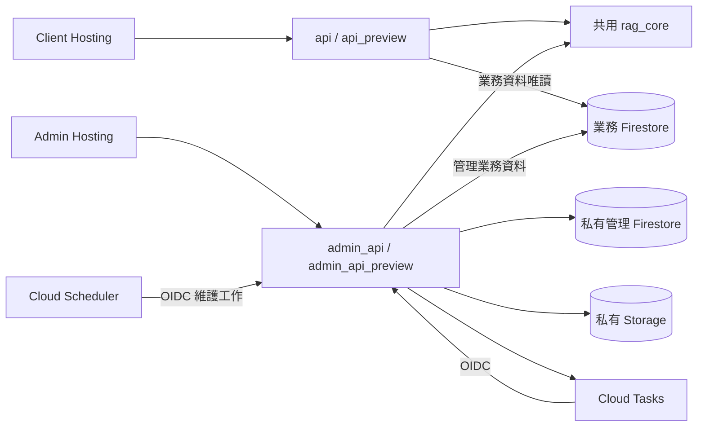

# Client／Admin 拆分與資料管理架構說明

本文說明專案拆分後的目錄結構、Client 與 Admin 服務責任、Firebase 環境隔離、Session 驗證、非同步工作佇列與檢索資料管理設計。日常啟動與部署步驟請見 [操作手冊](OPERATIONS.md)。

## 1. 目錄與服務責任

| 目錄 | 責任 |
| --- | --- |
| `client/frontend/` | 原使用者聊天介面、摘要、追問、瀏覽器隱私處理與使用者設定。管理登入與管理工具已移出。 |
| `client/backend/` | 公開聊天與健康檢查 HTTP 入口；只建立 client Flask application。 |
| `client/tests/` | 使用者聊天、串流、回應契約、前端行為與 client 封裝測試。 |
| `admin/frontend/` | 獨立登入、模型與流程設定、Prompt、Skills、診斷、批次預測與檢索資料庫管理。 |
| `admin/backend/` | 管理 HTTP API、Session 驗證、工作佇列、匯入／刪除資料及維運 CLI。 |
| `admin/tests/` | 管理登入、CSRF、版本衝突、非同步工作、資料管理與管理端評估工具的測試；`reliability/` 保存可重用評估程式與合成 fixtures。 |
| `shared/python/rag_core/` | 兩個後端共用的聊天服務、Agent、RAG、設定及 Skills 契約；不掛載管理 HTTP 路由。 |
| `shared/frontend/` | 兩個前端共用的型別與純邏輯。管理服務呼叫留在 admin。 |
| `infrastructure/` | Firestore 規則／索引、環境 IAM 與 CI 權限設計。 |
| `scripts/` | 分離封裝、部署、資源設定與可重用資料／品質工具。 |

資料來源 `data/` 與研究測試工作簿 `resource/` 獨立保存，不納入應用程式封裝。

圖中的資源依 production／preview 分開配置；共用 Python 套件不代表共用資料庫、Cookie 或服務帳號。

## 2. Firebase 與環境邊界

| 項目 | Production | Preview |
| --- | --- | --- |
| Client Function | `api` | `api_preview` |
| Admin Function | `admin_api` | `admin_api_preview` |
| 業務 Firestore | `(default)` | `app-dev` |
| 私有管理 Firestore | `admin-private` | `admin-private-dev` |
| Runtime Config 文件 | `runtime_config/app_main` | `runtime_config/app_dev` |
| Client runtime SA | `rag-client-prod` | `rag-client-dev` |
| Admin runtime SA | `rag-admin-prod` | `rag-admin-dev` |

Hosting target 為 `client` 與 `admin`，分別指向 `anti-harassment-bot`、`anti-harassment-bot-admin`。Preview 使用兩站各自的 Hosting channel，配合 `firebase.preview.json` 將 `/api/**` 改寫至 preview Function。Admin 固定使用同源 API；Client 部署仍以 `VITE_API_BASE_URL` 保留直接 Function API／SSE 路徑，本機未指定時由 Vite 代理 `/api`。Function 區域為 `asia-east1`。

命名資料庫 ID 至少需要 4 個字元，因此 dev 業務庫採用 `app-dev`。[Firestore 官方資料庫命名規則](https://docs.cloud.google.com/firestore/native/docs/manage-databases#database_id)

環境由部署設定決定，瀏覽器不能指定 database ID、collection path 或服務帳號。設定驗證會拒絕 production／preview 與資料庫名稱不一致的組合。Skills 也隨業務資料庫隔離；preview 不寫入 production 的 `scenario_scripts`。

Firestore Rules 設計為拒絕瀏覽器直接讀寫；伺服器使用 IAM。目標權限為 client 只讀自己的業務資料庫，admin 可管理同環境業務與私有資料庫。可使用 `scripts/verify_runtime_iam_operator.py` 對四個 runtime 服務帳號執行權限矩陣實測。

Functions 以兩個 codebase 封裝：`api` 來自 `build/functions/client`，`admin` 來自 `build/functions/admin`。[封裝腳本](../scripts/build_functions.py)只複製服務所需模組及共用 Python 程式；管理維運 CLI、測試、工作簿、本地憑證與虛擬環境不進部署來源。Hosting 只發布各自的 `frontend/dist`。

## 3. 管理登入與每次請求驗證

管理端使用伺服器 Session。瀏覽器提交密碼至 `POST /api/v1/admin/auth/login`；後端在同環境的私有資料庫讀取 `admin_credentials/shared`，使用 Argon2id 驗證雜湊。文件保存 `password_hash`、`enabled` 與 `auth_version`，不保存明文密碼。

登入成功時，後端產生隨機 Session token，瀏覽器只收到 `__session` Cookie。Cookie 設為 `HttpOnly`、`Secure`、`SameSite=Strict`；Firestore 只保存 token 的 SHA-256。管理前端不保存或傳送靜態 admin bearer key。

每個受保護請求都以 transaction 重新讀取 Session 與管理憑證，檢查環境、停用／撤銷狀態、`auth_version`、絕對有效期及閒置期限。預設登入有效期 8 小時，閒置 30 分鐘失效；登出撤銷該 Session，重設密碼提升 `auth_version` 使所有舊 Session 失效。私有資料庫無法驗證時回傳 503，不沿用無法確認的權限。

登入要求可信任的 `Origin`。所有修改請求還要求與 Session 綁定的 `X-CSRF-Token`，並再次核對 `Origin`。限流資料存在私有 Firestore，可跨 Function instance 生效；預設每來源登入 15 分鐘 5 次、全域 100 次，管理讀取每分鐘 600 次、修改每分鐘 120 次。

例外只有登入、公開健康檢查與 `/internal/` 工作路徑；internal 路徑使用獨立的 Google OIDC token 驗證，檢查簽章、issuer、audience、有效期及允許的 task service account email。公開可呼叫 Function 並不等於可通過其管理 API 驗證。

管理密碼透過後端 [password CLI](../admin/backend/admin_app/password_cli.py) 建立／重設；密碼不放在前端建置變數、GitHub log 或 URL。

## 4. 設定、Prompt、Skills 與診斷

模型、rerank、處理流程開關、Prompt 與 Skills 由 admin 管理，client 讀取已發布的業務設定。設定修改需要 `If-Match` 版本；缺少版本回傳 428，版本已變更回傳 409，避免兩個管理頁互相覆寫。Skills 使用單調增加的目錄版本，新增、更新、停用與刪除都會提升版本。

診斷入口為 `POST /api/v1/admin/test-jobs`。提交時保存 immutable 設定、Skills 與 Prompt 契約快照及 fingerprint；開始執行前再次檢查契約，若已過期則要求重新提交。執行中的診斷固定使用已核准快照，避免同一測試混用不同版本。

診斷工作綁定建立者 session，另一個 session 或不同環境的 GET／取消／重試均回 404；重新登入後不能存取舊 session 的診斷。Corpus 工作則對同環境已登入管理者提供分頁清單，可恢復、取消及明確重試。

批次預測（含法規分類與多輪對話行為測試）保留檔案／欄位選擇、逐案結果及匯出功能，呼叫管理端非同步診斷工作。測試工作不再經由 client 的管理路由。

## 5. 檢索資料庫與完整來源

管理 API 以 `kind=law|judgment|remedy` 對應既定集合，提供資料記錄、來源清單、來源詳細 chunks 與可用的原始檔下載。回應不允許使用者提供任意 Firestore 路徑。

新增資料採三階段：

1. **上傳與預覽**：`POST /api/v1/admin/corpus/imports/preview` 先保存原始檔並回 202，透過 `corpus_parse` 工作解析。結構化檔案先列出欄位與樣本，管理者明確對應本文、metadata／來源欄位後，再排入解析產生完整 chunks 預覽；可從伺服器草稿恢復。此階段不呼叫 embedding、不寫入可檢索業務集合。原始檔與歷次預覽內容以不可覆寫的物件版本保存在私有 Storage，私有 Firestore 保存 parse revision 與計畫雜湊；確認 reservation 防止重新對應欄位與確認並行而發布錯誤版本。
2. **確認與建立工作**：`POST /api/v1/admin/corpus/imports/{id}/confirm` 必須帶回 `plan_hash`。確認綁定環境、模型、維度與內容；重複確認可取得同一工作，不能改用另一份預覽內容。
3. **Embedding 與發布**：worker 逐批執行 embedding，保存已完成向量與 checkpoint；檢查維度與數值後，在業務 transaction 原子發布來源 manifest、chunks、重複識別鍵及收據。讀取端不會看到只完成一半的匯入。

支援 JSON、JSONL、CSV、XLSX、TXT、Markdown、PDF、DOCX。單檔最多 5 MiB，最多 100 chunks、140,000 個擷取文字字元；每 chunk 最多 64 KiB、metadata 最多 8 KiB，PDF 最多 100 頁。超過上限會拒絕，不截斷。PDF 只擷取文字，掃描 PDF 需要 OCR 而目前不支援。

來源刪除需要目前 revision，工作只處理該來源已確認擁有的 chunks、manifest 與資產。API 沒有以任意 collection／document path 刪除資料的入口。

既有資料的 `metadata.source_file` 可協助建立來源目錄，但只有分組與 chunk index／count 完整、snapshot hash 可核對的來源才可納入受管理 manifest。若舊資料只剩文字 chunks，UI 會顯示原始檔不可用。來源不明、不完整或尚未核對的 legacy 記錄維持唯讀。

## 6. 工作耐久性、取消與資料保留

診斷、解析、匯入與刪除使用私有 `admin_jobs` 與 Cloud Tasks。Cloud Tasks 呼叫同環境 admin Function 的 `/internal/jobs/{job_id}/run`。工作 ID、派送 generation、lease 與 checkpoint 處理重複投遞及中斷；背景工作不依賴 HTTP 回應後繼續執行的 Python thread。

worker 在外部計費呼叫前後記錄狀態。若呼叫已開始但無法確認結果，工作進入 `needs_review`，不自動再次計費；明確重試必須承認重複成本。已保存結果的 checkpoint 可續跑，完成的向量不因一般重送而重新計算。取消會在檢查點停止後續工作，不能撤銷已送出的模型請求或返還已發生費用。

Scheduler 每 5 分鐘呼叫同一服務的維護路徑，補發耐久化後尚未成功派送的工作、處理過期 lease，並清理到期且尚未確認的匯入預覽。未確認預覽的刪除有寬限時間與 transaction 狀態核對；已確認或仍有關聯工作的原始檔不依預覽到期時間直接刪除。

診斷工作 API 保存 24 小時，一般匯入／刪除工作保存 7 天；大量 payload／結果放入私有 Storage。本機 `worker_cli` 只處理 development 工作，雲端 Scheduler 也只派送自己環境。TTL、Storage lifecycle 及 Scheduler 透過 [worker 設定腳本](../scripts/configure_admin_workers.py) 部署生效。

## 7. CI/CD 與維運分工

GitHub Actions 的 `main` 與 `dev` workflow 先通過 CI，再依路徑變更選擇 client、admin 或兩者。共用程式、封裝、基礎設施或工作流程變更會驗證並部署兩者。部署使用 [deploy.py](../scripts/deploy.py)，先完成 Functions 再發布 Hosting，避免前端先切換到尚未更新的 API。

Workflow 採用 Workload Identity Federation 的短期憑證介面；權限設計與 Firebase CLI 限制記錄於 [CI 部署權限審查](../infrastructure/iam/CI_DEPLOYMENT_REVIEW.md)。

環境初始化、業務資料搬遷、資料庫索引與 TTL、Storage、Tasks、Scheduler 及密碼建立屬於管理維運；日常 CI 不應取得任意資料讀寫、專案 IAM 修改或憑證管理能力。

## 8. 安全與架構邊界摘要

| 面向 | 架構保證與限制 |
| --- | --- |
| 服務拆分 | Client 與 Admin 擁有獨立的前後端與來源封裝；Client production bundle 不含管理 API 或控制項，Admin production bundle 不輸出實驗性遮罩驗證頁。 |
| 權限隔離 | 四個 Firestore 資料庫皆拒絕瀏覽器直連；Client runtime SA 僅具同環境業務庫唯讀權限，Admin runtime SA 僅能存取同環境業務庫與私有庫。 |
| 共用設定快取 | Client 一般設定快取約 30 秒、Skills 快取約 60 秒；儲存設定需比對 `If-Match` revision，防止併發覆寫。 |
| 瀏覽器遮罩實驗 | 瀏覽器端 WebGPU 小模型遮罩驗證頁位於 Admin 的 `masking-lab`，供離線與合成資料集評估使用，正式聊天仍維持既有規則遮罩流程。 |
