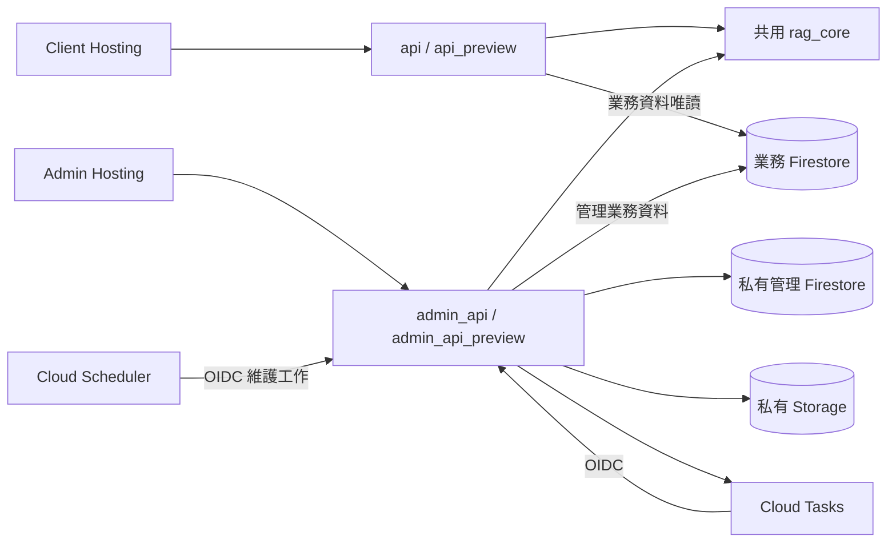

# Client／Admin 拆分與資料管理遷移報告

更新日期：2026-10-10。本文描述目前工作目錄與已取得的驗證證據。**兩個 Preview Functions 與網站已更新部署；Runtime IAM 的 32 項實測、完整業務資料複製及 GitHub CI 已通過；正式 Admin 已發布，Production Client 切換與 WIF 部署仍在進行。** 真實背景工作與合成匯入已執行，已知失敗及待補驗收列於第 9 節；不把本機測試或部分線上成功等同整體遷移完成。

## 1. 目錄與服務責任

| 目錄 | 責任 |
| --- | --- |
| `client/frontend/` | 原使用者聊天介面、摘要、追問、瀏覽器隱私處理與使用者設定。管理登入與管理工具已移出。 |
| `client/backend/` | 公開聊天與健康檢查 HTTP 入口；只建立 client Flask application。 |
| `client/tests/` | 使用者聊天、串流、回應契約、前端行為與 client 封裝測試。 |
| `admin/frontend/` | 獨立登入、模型與流程設定、Prompt、Skills、診斷、批次預測、對話行為測試及檢索資料庫管理。 |
| `admin/backend/` | 管理 HTTP API、Session 驗證、工作佇列、匯入／刪除資料及維運 CLI。 |
| `admin/tests/` | 管理登入、CSRF、版本衝突、非同步工作、資料管理與管理端評估工具的測試；`reliability/` 保存可重用評估程式與合成 fixtures。 |
| `shared/python/rag_core/` | 兩個後端共用的聊天服務、Agent、RAG、設定及 Skills 契約；不掛載管理 HTTP 路由。 |
| `shared/frontend/` | 兩個前端共用的型別與純邏輯。管理服務呼叫留在 admin。 |
| `infrastructure/` | Firestore 規則／索引、環境 IAM 與 CI 權限設計。 |
| `scripts/` | 分離封裝、部署、資源設定與可重用資料／品質工具。 |

舊 `frontend/`、`backend/`、根目錄 `main.py` 與混合 `tests/` 已依上述責任搬遷。資料來源 `data/`、人工維護的 `resource/` 工作簿不屬於程式拆分或清理範圍。

圖中的資源依 production／preview 分開配置；共用 Python 套件不代表共用資料庫、Cookie 或服務帳號。

## 2. Firebase 與環境邊界

| 項目 | Production | Preview |
| --- | --- | --- |
| Client Function | `api` | `api_preview` |
| Admin Function | `admin_api` | `admin_api_preview` |
| 業務 Firestore | `(default)` | `app-dev` |
| 私有管理 Firestore | `admin-private` | `admin-private-dev` |
| Runtime Config 文件 | `runtime_config/app_main` | `runtime_config/app_dev` |
| Client runtime SA | `rag-client-prod` | `rag-client-dev` |
| Admin runtime SA | `rag-admin-prod` | `rag-admin-dev` |

Hosting target 為 `client` 與 `admin`，分別指向 `anti-harassment-bot`、`anti-harassment-bot-admin`。Preview 使用兩站各自的 Hosting channel，配合 `firebase.preview.json` 將 `/api/**` 改寫至 preview Function。Admin 固定使用同源 API；Client 部署仍以 `VITE_API_BASE_URL` 保留直接 Function API／SSE 路徑，本機未指定時由 Vite 代理 `/api`。Function 區域為 `asia-east1`。

命名資料庫 ID 至少需要 4 個字元，因此原先構想的 `dev` 無法建立，實作採用 `app-dev`。這是平台命名限制，並非另建 production 資料庫。[Firestore 官方資料庫命名規則](https://docs.cloud.google.com/firestore/native/docs/manage-databases#database_id)

環境由部署設定決定，瀏覽器不能指定 database ID、collection path 或服務帳號。設定驗證會拒絕 production／preview 與資料庫名稱不一致的組合。Skills 也隨業務資料庫隔離；preview 不再直接寫入 production 的 `scenario_scripts`。

Firestore Rules 設計為拒絕瀏覽器直接讀寫；伺服器使用 IAM。目標權限為 client 只讀自己的業務資料庫，admin 可管理同環境業務與私有資料庫。**規則檔、本地 fake 測試與 Emulator 都不能證明雲端 IAM 已正確生效**；跨環境拒絕與 client 寫入拒絕必須實測。

Functions 以兩個 codebase 封裝：`api` 來自 `build/functions/client`，`admin` 來自 `build/functions/admin`。[封裝腳本](../scripts/build_functions.py)只複製服務所需模組及共用 Python 程式；管理維運 CLI、測試、工作簿、本地憑證與虛擬環境不進部署來源。Hosting 只發布各自的 `frontend/dist`。

## 3. 管理登入與每次請求驗證

管理端使用伺服器 Session。瀏覽器提交密碼至 `POST /api/v1/admin/auth/login`；後端在同環境的私有資料庫讀取 `admin_credentials/shared`，使用 Argon2id 驗證雜湊。文件保存 `password_hash`、`enabled` 與 `auth_version`，不保存明文密碼。

登入成功時，後端產生隨機 Session token，瀏覽器只收到 `__session` Cookie。Cookie 設為 `HttpOnly`、`Secure`、`SameSite=Strict`；Firestore 只保存 token 的 SHA-256。管理前端不再保存或傳送舊的靜態 admin bearer key。

每個受保護請求都以 transaction 重新讀取 Session 與管理憑證，檢查環境、停用／撤銷狀態、`auth_version`、絕對有效期及閒置期限。預設登入有效期 8 小時，閒置 30 分鐘失效；登出撤銷該 Session，重設密碼提升 `auth_version` 使所有舊 Session 失效。私有資料庫無法驗證時回傳 503，不沿用無法確認的權限。

登入要求可信任的 `Origin`。所有修改請求還要求與 Session 綁定的 `X-CSRF-Token`，並再次核對 `Origin`。限流資料存在私有 Firestore，可跨 Function instance 生效；預設每來源登入 15 分鐘 5 次、全域 100 次，管理讀取每分鐘 600 次、修改每分鐘 120 次。

例外只有登入、公開健康檢查與 `/internal/` 工作路徑；internal 路徑使用獨立的 Google OIDC token 驗證，檢查簽章、issuer、audience、有效期及允許的 task service account email。公開可呼叫 Function 並不等於可通過其管理 API 驗證。

這個版本仍是共用管理密碼，不是每人具名帳號，也沒有 MFA 或細分管理角色。管理密碼透過後端 [password CLI](../admin/backend/admin_app/password_cli.py)建立／重設；密碼不放在前端建置變數、GitHub log 或 URL。

## 4. 設定、Prompt、Skills 與診斷

模型、rerank、處理流程開關、Prompt 與 Skills 由 admin 管理，client 讀取已發布的業務設定。設定修改需要 `If-Match` 版本；缺少版本回傳 428，版本已變更回傳 409，避免兩個管理頁互相覆寫。Skills 使用單調增加的目錄版本，新增、更新、停用與刪除都會提升版本。

診斷入口為 `POST /api/v1/admin/test-jobs`。提交時保存 immutable 設定、Skills 與 Prompt 契約快照及 fingerprint；開始執行前再次檢查契約，若已過期則要求重新提交。執行中的診斷固定使用已核准快照，避免同一測試混用不同版本。

診斷工作綁定建立者 session，另一個 session 或不同環境的 GET／取消／重試均回 404；重新登入後不能存取舊 session 的診斷。Corpus 工作則對同環境已登入管理者提供分頁清單，可恢復、取消及明確重試。

批次預測與對話行為測試保留檔案／欄位選擇、逐案結果及匯出功能，呼叫管理端非同步診斷工作。測試工作不再經由 client 的管理路由。實際模型請求可能計費；合成 fixture 或 mock 測試通過只證明程式契約與流程，不證明模型、法律判斷或真實使用情境品質。

## 5. 檢索資料庫與完整來源

管理 API 以 `kind=law|judgment|remedy` 對應既定集合，提供資料記錄、來源清單、來源詳細 chunks 與可用的原始檔下載。回應不允許使用者提供任意 Firestore 路徑。

新增資料採三階段：

1. **上傳與預覽**：`POST /api/v1/admin/corpus/imports/preview` 先保存原始檔並回 202，透過 `corpus_parse` 工作解析。結構化檔案先列出欄位與樣本，管理者明確對應本文、metadata／來源欄位後，再排入解析產生完整 chunks 預覽；可從伺服器草稿恢復。此階段不呼叫 embedding、不寫入可檢索業務集合。原始檔與歷次預覽內容以不可覆寫的物件版本保存在私有 Storage，私有 Firestore 保存 parse revision 與計畫雜湊；確認 reservation 防止重新對應欄位與確認並行而發布錯誤版本。
2. **確認與建立工作**：`POST /api/v1/admin/corpus/imports/{id}/confirm` 必須帶回 `plan_hash`。確認綁定環境、模型、維度與內容；重複確認可取得同一工作，不能改用另一份預覽內容。
3. **Embedding 與發布**：worker 逐批執行 embedding，保存已完成向量與 checkpoint；檢查維度與數值後，在業務 transaction 原子發布來源 manifest、chunks、重複識別鍵及收據。讀取端不會看到只完成一半的匯入。

支援 JSON、JSONL、CSV、XLSX、TXT、Markdown、PDF、DOCX。單檔最多 5 MiB，最多 100 chunks、140,000 個擷取文字字元；每 chunk 最多 64 KiB、metadata 最多 8 KiB，PDF 最多 100 頁。超過上限會拒絕，不能悄悄截斷。PDF 只擷取文字，掃描 PDF 需要 OCR 而目前不支援；PDF 表格／閱讀順序、DOCX 圖片文字仍需管理者核對。

來源刪除需要目前 revision，工作只處理該來源已確認擁有的 chunks、manifest 與資產。API 沒有以任意 collection／document path 刪除資料的入口。

既有資料的 `metadata.source_file` 可協助建立來源目錄，但只有分組與 chunk index／count 完整、snapshot hash 可核對的來源才可納入受管理 manifest。**若舊資料只剩文字 chunks，無法由此證明或還原當年的完整原始檔**；UI 必須顯示原始檔不可用。來源不明、不完整或尚未核對的 legacy 記錄維持唯讀，不宣稱已完成原始檔管理。

## 6. 工作耐久性、取消與資料保留

診斷、解析、匯入與刪除使用私有 `admin_jobs` 與 Cloud Tasks。Cloud Tasks 呼叫同環境 admin Function 的 `/internal/jobs/{job_id}/run`，沒有新增第五或第六個 HTTP Function。工作 ID、派送 generation、lease 與 checkpoint 處理重複投遞及中斷；背景工作不依賴 HTTP 回應後繼續執行的 Python thread。

worker 在外部計費呼叫前後記錄狀態。若呼叫已開始但無法確認結果，工作進入 `needs_review`，不自動再次計費；明確重試必須承認重複成本。已保存結果的 checkpoint 可續跑，完成的向量不因一般重送而重新計算。取消會在檢查點停止後續工作，不能撤銷已送出的模型請求或返還已發生費用。

Scheduler 每 5 分鐘呼叫同一服務的維護路徑，補發耐久化後尚未成功派送的工作、處理過期 lease，並清理到期且尚未確認的匯入預覽。未確認預覽的刪除有寬限時間與 transaction 狀態核對；已確認或仍有關聯工作的原始檔不依預覽到期時間直接刪除。

診斷工作 API 保存 24 小時，一般匯入／刪除工作保存 7 天；大量 payload／結果放入私有 Storage。本機 `worker_cli` 只處理 development 工作，雲端 Scheduler 也只派送自己環境；兩者雖使用相同 dev 私有庫，不能交叉執行。TTL、Storage lifecycle 及 Scheduler 需透過 [worker 設定腳本](../scripts/configure_admin_workers.py)部署才會生效。TTL 與 lifecycle 是非同步清理，不承諾到期瞬間完成物理刪除；主動匯入來源不套用短期工作保留政策。

## 7. CI/CD 與維運分工

GitHub Actions 的 `main` 與 `dev` workflow 先通過 CI，再依路徑變更選擇 client、admin 或兩者。共用程式、封裝、基礎設施或工作流程變更會驗證並部署兩者。部署使用 [deploy.py](../scripts/deploy.py)，先完成 Functions 再發布 Hosting，避免前端先切換到尚未更新的 API。

Workflow 已改用 Workload Identity Federation 的短期憑證介面；雲端 provider、精確 repository／branch／workflow 條件、runtime SA 與部署權限仍須實際配置驗證。權限候選設計與 Firebase CLI 限制記錄於 [CI 部署權限審查](../infrastructure/iam/CI_DEPLOYMENT_REVIEW.md)。不要因為 workflow 檔可解析就視為 GitHub 部署已成功。

環境初始化、業務資料搬遷、資料庫索引與 TTL、Storage、Tasks、Scheduler 及密碼建立屬於管理維運；日常 CI 不應取得任意資料讀寫、專案 IAM 修改或憑證管理能力。本地來源封裝檢查也不能取代實際上傳封包與線上端到端驗證。

## 8. 目前限制與驗證狀態

| 項目 | 本地可確認內容 | 線上證據與驗證限制 |
| --- | --- | --- |
| 服務拆分 | 兩組前後端與來源包已建立；Preview 已部署，Admin 真實 Hosting→API 登入及讀取已驗證 | 正式 Admin 後端、網站與背景工作已建立；Production Client 仍待切換及線上驗收 |
| 管理驗證 | 本地安全測試；真實 Admin Preview 登入、Cookie 轉送、七分頁讀取、登出後 401 已驗證 | 密碼輪替、過期、限流及私有庫失敗已有本地故障測試；線上負向請求與正式站驗收另記錄，不把本地結果稱為雲端故障注入 |
| 環境隔離 | 固定 database mapping；四庫 Rules Emulator 匿名／Firebase Auth 拒絕矩陣已通過；Preview UI 確認 app_dev | Runtime SA 的跨庫拒絕／Client 寫入拒絕 32 項實測已通過；WIF 實際部署仍在執行 |
| 共用設定 | 真實 Admin PUT 後 Client 採用旗標；測試文件已安全移除，Admin／Client 恢復預設 | 本地兩份獨立快取各於 30 秒 TTL 採用新 revision；線上送出起 30.980 秒／成功回應起約 24.851 秒，原嚴格 gate 未通過，未直接量測所有 instances |
| 非同步工作 | 本地重送／checkpoint／取消測試；真實 Tasks／OIDC 已成功執行診斷與 corpus 工作，Scheduler 定時呼叫回 200，TTL／lifecycle 設定已套用 | 中斷、重送及 Storage 清理失敗由本地故障測試覆蓋；未對雲端服務注入破壞性故障 |
| 資料管理 | 第二輪真實端到端 26 項檢查通過，含確認前零向量、重複確認、原生向量搜尋、原檔比對與整份刪除清理 | 第一輪完成後重送曾收到未定位的 500；1,046 筆業務資料複製及兩環境各 246 個舊來源 catalog 核對已通過 |
| 模型品質 | 保留可重跑評估工具及合成 fixtures | 不由程式測試推定模型正確率或法律專家品質 |
| 瀏覽器遮罩實驗 | 驗證頁已移至 admin 的 masking lab；production build 不輸出該實驗入口 | 既有 Qwen3-0.6B／v2 提示組合曾未通過合成評估，未接管正式聊天 |
| 文件與清理 | 操作手冊與本報告已撰寫；四份技術文件／手冊更新新架構、14 頁 PDF 渲染及 8 個 HTML 桌面／手機檢查通過 | 多餘檔案已盤點；依要求待計畫驗收完成後才執行最終刪除 |

最終交付應補入本次完整測試、瀏覽器畫面、真實雲端驗證及部署紀錄；過往驗收數字與舊 screenshot 不能替代本次證據。資料來源、工作簿、合成測試資料、可重用工具與可編輯正式文件應保留。一次性 debug logs、舊驗證清單及 captured response 可在功能完成、回歸案例保留、相依連結修正後依清理清單移除。

## 9. 本次已驗證證據與未完成驗收

完整 Python 回歸 **1,397 tests** 通過（2026-10-10 09:44）；全專案 Ruff check／format 通過，159 個 Python 檔案格式一致。這一輪包含 IAM 探針的錯誤分類、保留路徑拒絕、短期授權及清理防護，以及驗證層錯誤紀錄不洩漏敏感內容的測試；後續新增修正仍需重新驗證，不將舊數字視為所有未來變更的結果。

本次前端回歸共 **654 tests**（shared 82、Client 340、Admin 232），workspace lint、production build 與 Admin preview build 通過。Client production bundle 未包含管理 API／控制項；Admin production build 不輸出 masking-validation 入口與模型 worker。合成桌面／手機瀏覽器測試涵蓋設定、批次暫停／續跑與 Excel、對話多輪與報表／離線覆核、資料預覽確認／全文／刪除，以及排隊解析、明確欄位對應、分頁切換保留草稿、重新載入恢復、需要檢查工作的重試成本確認與取消；不等於真實模型或正式資料驗證。

2026-10-10 約 03:11–03:12（Asia/Taipei），[Admin Preview](https://anti-harassment-bot-admin--dev-preview-q53x908r.web.app) 在 1440×1050 與 390×844 實際 Chrome 中通過密碼登入、七分頁、環境 `preview`、設定文件 `app_dev`、來源清單讀取（當時 0 筆）與登出後 session API 401。實際 `__session` Cookie 為 Secure／HttpOnly／SameSite=Strict，JavaScript 不可讀；未保存舊 admin token，無頁面錯誤或水平溢出。此項驗證沒有上傳、設定寫入或模型請求，密碼未記錄於輸出。報告與 16 張截圖位於本機 `/tmp/rag-live-admin-preview-smoke/`，不是交付必備依賴。

`pnpm test:rules` 以 Firebase CLI 15.33.0／Firestore Emulator 1.22.0 對 `demo-rag-harass-bot` 執行真實 Rules 測試：11 tests 全數通過，四庫、15 個 collections、640 次拒絕操作；包含讀取、查詢、新增、修改、刪除、巢狀及已存在文件。先以短暫測試規則正向確認各庫的 `request.auth.uid` 與 `admin: true` claim，再恢復拒絕規則；因此不會把未帶登入身分的拒絕誤算成已登入驗證。一般測試在沒有 Emulator 時明確顯示 skip，CI 有獨立的 Emulator job。設定限制與操作方式見 [Rules 測試說明](../infrastructure/tests/README.md)。

來源封裝已使用各自匯出的 dependencies，在獨立虛擬環境載入 Client／Admin 入口並驗證路由分離；Client 沒有 Admin app、Argon2 或 Excel 依賴，Admin 沒有 Client app。清單檢查排除憑證、測試、維運 CLI、虛擬環境及快取，並以合成檔案確認秘密檔名與 symlink 會被拒絕。這是本地封裝清單，不代表雲端目前版本永遠與正在修改的工作目錄相同；任何後續改動必須重新封裝並部署。

2026-10-10 03:47（Asia/Taipei），Preview 兩站 Hosting 與後端部署成功。之後於 04:11–04:12 部署下述 Gemini schema 修正；目前 Client 修訂版為 `api-preview-00028-guj`，Admin 為 `admin-api-preview-00006-qib`。兩者均為 ACTIVE，使用各自的 dev service account、`app-dev` 與 `app_dev`，Admin 另使用 `admin-private-dev`。部署 metadata 確認沒有本機 `RAG_FUNCTION_DISCOVERY` 旗標，且模型 Secret binding 存在。兩站 Hosting channel 到期時間為 2026-11-08 19:47 UTC。目前封裝清單為 Client 43、Admin 50 個必要檔案。

部署曾在 PATH 選到本機另一個獨立 Firebase 執行檔時，於 Client 分析階段失敗；明確改用 Firebase CLI 15.33.0／Node 24 後成功。部署腳本已加入精確 CLI 版本檢查。Worker 設定也修正 Scheduler 建立／更新的 header 參數差異，已成功重跑 Preview 設定；三個 dev 向量索引與兩個私有庫各四個工作索引均 READY。

另以唯讀 metadata 與 Cloud Run HTTP logs 核對維護排程：`rag-admin-reconcile-dev` 為 ENABLED，使用 dev task SA 的 OIDC；03:50 至 04:15 每五分鐘的 `/internal/maintenance/reconcile` 均回 200，04:15 已由目前 Admin 修訂版執行。此證據確認實際定時觸發及驗證通過，不替代注入故障後的復原或到期資料物理清除驗證。

03:49 起的第一輪線上寫入驗證確認：真實診斷建立回 202，相同冪等鍵回同一 job；另一個 session 的查詢／取消／重試均 404，登出後回 401，Cookie flags 正確。Cloud Tasks worker 執行並回 204，但該診斷的 `google/gemini-2.5-pro` 請求收到上游 HTTP 400（SDK `BadRequestError`），由應用回報 `upstream_request_rejected`／502；沒有自動重試。公開模型目錄仍列有該模型及 structured output 支援；私有診斷日誌刻意不保存上游本文，當時尚未確認確切原因，後續定位如下。

後續另以該合成 job 的凍結 payload／設定／Skills 精確重現一次，限制最多一個模型 HTTP 請求且關閉重試。記憶體內讀取上游原因後，安全分類確認為 `schema_too_complex`／`INVALID_ARGUMENT`；沒有保存原始 request、error body 或 key。[Google 官方文件](https://docs.cloud.google.com/gemini-enterprise-agent-platform/models/capabilities/control-generated-output#considerations)亦列明複雜 schema 與多種欄位限制可能導致 400。相容修正降低 Gemini 端 schema 的限制數量，保留本機完整 Pydantic 契約與來源檢查。

相容修正已完成：只對 `google/gemini-*` 複製 provider schema，去除字串／陣列的正數長度界線與 pattern；`maxItems=0`、來源 enum、路由 union、required／禁止額外欄位及所有本機 validators 保留。涵蓋 legacy、v2／v3／v4、串流、工具後續呼叫與 prediction 兩階段。新增 37 項 regression 與獨立串流拒絕探針通過；Gemini 契約指紋同時保留原本本機 schema 並納入實際 provider 格式。另一次單一 HTTP 相容性驗證先核對原 kwargs SHA-256 完全一致，再只替換 response_format；同模型、同 1,200 token 上限回 HTTP 200／`finish_reason=stop`，原本完整 Pydantic 與離線 `run_chat_test` 重播均通過。兩個 Preview 後端已重新部署，43／50 個來源檔與獨立載入檢查通過。

04:12–04:14 的修正版線上驗證通過：新建診斷使用新契約指紋、同一模型與 1,200 token 上限，回 202 並經 Cloud Tasks 成功完成；同 key 重送取得同一 job，完整 v4 回應通過驗證。該工作只呼叫模型一次，無 embedding／retrieval；Cookie flags 及登出後 401 再次通過。

同輪合成 corpus 已通過背景欄位掃描、明確欄位對應、背景預覽、確認前無來源發布／無向量 staging、重複確認同一工作，以及兩段文字的真實 embedding／原子發布。完成後再次 confirm 曾收到 HTTP 500；限定來源與時間的 Cloud Run logs 沒有對應的第三次 confirm 請求或 stack，尚不能斷言為後端 SDK 缺陷。測試已停止並刪除本次來源；獨立只讀後驗確認來源 tombstone、兩筆 chunks／draft／embeddings staging／source-assets 均已移除，原始檔／預覽及本次 Storage prefix 的現行與封存 generations 為空。該輪未執行到 native nearest 與原檔 byte comparison，因此不列為通過。

同一版本後續以真實 Firestore SDK／Emulator 檢查完成後確認：有／無已保存 job link 各 20 次重送及外部 result reference 分支均回相同結果，沒有新增 embedding 或派送；沒有為此修改 runtime。經明確追加一次合成測試後，第二輪完整 corpus **26 項檢查全部通過**：排隊解析／欄位對應、確認前無向量、三次確認同一 job（含完成後）、兩筆原生 1024 維 Vector 的來源綁定及各自 `findNearest`、分頁讀回、原檔 bytes／hash 比對、整份刪除、原始與預覽物件 generation 消失、draft／staging／assets／chunks 清除，以及刪除後兩次 nearest 均無本次來源。完成登出且沒有殘留本次合成來源。第二輪報告位於 `/tmp/rag-preview-corpus-smoke-20261010-r2.json`；第一輪失敗並未被此結果抹除。

Client 另外只送出一次原先排定的合成聊天：直接 API 回 HTTP 200／`text/event-stream`，進度在約 161／671／928 ms 分批到達，約 10.3 秒收到不可重試的 `upstream_request_rejected`。畫面及歷史正確呈現失敗、未自動重送，舊 Admin 路由 404；這證明實際串流與錯誤處理可達，但**沒有成功回答的 delta／done 證據**。

修正版 Client 另送出一次合成聊天後成功：HTTP 200／`text/event-stream`，7,708 ms 在第 5 個網路 chunk 收到文字 delta，7,961 ms 在第 6 個 chunk 收到通過 v4 parser 的 done；兩者相隔 253 ms。只送出一次 chat POST、一次模型請求，沒有自動重試或 embedding／retrieval。一則使用者及一則助手訊息已保存，重新載入後瀏覽器儲存與側欄歷史項目仍在，無頁面錯誤。重載後預設回首頁，不宣稱自動重開該對話。證據位於 `/tmp/rag-live-final-preview-smoke-r2/verification.json`，先前失敗紀錄完整保留。

共用設定以原本不存在的 `app-dev/runtime_config/app_dev` 執行可還原測試：Admin 僅 PUT 一次 `enable_image_upload=false`，帶 `If-Match: defaults`；確認新建文件的 revision、完整內容及建立／更新時間後，才允許以 transaction 比對相同版本並刪除，恢復原本無文件的狀態。首次腳本錯將 `SERVER_TIMESTAMP` 欄位要求等於文件 metadata 時間；[Firestore 官方定義](https://firebase.google.com/docs/firestore/reference/rpc/google.firestore.v1#google.firestore.v1.DocumentTransform.FieldTransform.ServerValue)中的 REQUEST_TIME 為毫秒精度的處理時間，因此該條件不成立。腳本停止後，以唯讀證據確認文件建立在本次 PUT 時段、建立時間等於更新時間、內容僅有預定旗標差異，才依固定 fingerprint／revision／時間戳安全還原；沒有因此修改應用程式。

修正此量測腳本並通過 28 項離線 guard 檢查後，第二輪實際觀測 Client 連續三次採用 false：從 PUT 送出起算 **30.980 秒**，PUT 本身往返 6.129 秒，故從成功回應起約 **24.851 秒**。原始腳本以送出前的時間作為嚴格 30 秒 gate，報告仍保留 `passed=false`，不更改計時基準宣稱原 gate 通過。設定還原後，Client 在 **27.525 秒**內連續三次回到 true；最終 operator 確認文件不存在、Admin 回 defaults，登出後 session 回 401，零模型呼叫。此結果證明抽樣請求採用設定與安全還原；未直接量測 Firestore 提交時間或證明所有 instances 的版本。兩輪報告與獨立還原記錄保存於 `/tmp/rag-admin-migration-20261010/preview-config-smoke*.json`，目標文件保持不存在，不影響後續正式資料複製。

以下區分剩餘交付與已驗證範圍，不以本地或抽樣證據擴大宣稱：

- Production Client 切換與舊管理路徑停用、最終模型驗收及 WIF 真實 GitHub 部署仍待完成。Runtime IAM、業務資料複製、舊來源 catalog 完整性及前述版本的獨立 GitHub CI 已通過。
- 結構化欄位對應、背景解析、匯入草稿恢復與工作清單／重試／取消 UI 已通過本地回歸與 1440／390 px 合成瀏覽器流程；第二輪真實 corpus 全流程通過。第一輪 500 保留為未定位、後續未重現事件；中斷／Storage 失敗恢復由本地故障測試覆蓋，不宣稱已完成雲端故障注入。
- 設定快取的本地驗證確認：兩份獨立快取各自在 30 秒期限到達時讀入相同新 revision 與設定值，頻繁讀取不延長期限。結合上述線上旗標採用／還原證據，支持原計畫「約 30 秒快取」的功能行為；不代表網路延遲 SLA 或所有線上 instances 的 revision 已直接量測，原嚴格 gate 仍保留失敗。Preview 業務設定已完成複製及核對，以下記錄最終資料結果。

2026-10-10 09:18，四個 runtime service accounts 的真實 Firestore IAM 矩陣通過 **32／32 項**：16 次讀取為 6 次允許（合成文件不存在，404）及 10 次拒絕（403）；16 次 create-only 寫入為 4 次允許及 12 次拒絕。四個新建合成文件均由建立者服務帳號以 updateTime precondition 刪除成功，operator 最終確認四庫固定 probe path 全部 404。四個臨時 Token Creator binding 均已移除，且各 SA 的其他 bindings 與執行前完全一致。沒有讀取業務 collections 或呼叫模型。

第一次嘗試因 IAM 授權傳播尚未完成而無法取得 token；第二次因探針 collection 使用 Firestore 保留名稱而收到 400，均未完成矩陣且已撤除臨時授權。修正為合法 `migration_permission_probe/not-present`、加入保留名稱離線拒絕及有界傳播等待後，第三次完成上述實測，始終保留原核准的 30 分鐘到期時間。成功報告為 `/tmp/rag-admin-migration-20261010/runtime-iam-approved-result-r3.json`，先前失敗記錄保留；可重用流程見 [Runtime IAM 實測](RUNTIME_IAM_PROBE.md)。

2026-10-10 09:29，正式 `(default)` 至 `app-dev` 的 **1,046 筆 create-only 複製及完整核對通過**：Runtime Config 1、Skills 10、法規 5、判決 1,026、求助資源 4。逐筆來源與目標 hash 皆相同、目標無額外文件；正式來源的全量 allowlist inventory 未變。1,035 筆 embedding 均維持原生 Firestore Vector、1,024 維，沒有缺失或轉成普通陣列。重新建立對照計畫時，全部 1,046 筆均為 unchanged。複製沒有包含管理憑證、sessions、jobs 或聊天紀錄，沒有呼叫 embedding／模型。

該次 Runtime Config 的模型為 `openai/gpt-5.6-luna`、上限 4,800 tokens；原有 Prompt、Skills 與流程設定已保留。09:50 完成兩環境各 **246 個來源／1,035 筆分段**的 legacy catalog：各自從同環境資料建立來源、去重 key、私有 asset 與固定 generation manifest，全部逐項核對通過。最終再查 1,046 筆業務文件，正式來源 inventory hash 未變、dev 仍為完整相同複本；沒有修改原本 RAG rows、呼叫 embedding 或上傳原件。必要 checkpoint 與原始 catalog 空狀態備份保留於已排除 Git 的 `.admin-local/migrations/20261010/catalog/`。即使 repo 存有對應 Markdown，也不將路徑存在或部分重建相符視為當年原檔 bytes 已證明；本次不回填或宣稱原檔可下載。

複製後的 Preview 複驗通過未登入、Cookie、路由隔離、OIDC、CSRF／Origin 與 collection 負向檢查，但唯一一次診斷提交在 09:33 回 503，當輪立即停止，Client 聊天沒有送出。唯讀追查確認 exact job 及 Cloud Task 均不存在；該 session 的寫入限流文件直到後續登出才建立，因此失敗請求尚未通過驗證 middleware，沒有進入診斷 route 或模型執行。原驗證層沒有保存錯誤類型，不能斷言為 transaction contention。已補充只含階段、錯誤類型、白名單 Google 狀態碼、error ID 與有效 trace 的安全紀錄，503 回應亦附 error ID；新增 9 項測試確認不記錄例外本文、堆疊、密碼、Cookie、CSRF 或請求內容，且不增加重試或改動驗證語義。修正已部署至兩個 Admin Functions，後續複驗結果另記於下段。失敗報告與唯讀追查分別保留於 `/tmp/rag-live-final-smoke-preview-r2/` 及 `/tmp/rag-admin-migration-20261010/preview-submit503-auth-metadata.json`。

[GitHub CI run 38013224699](https://github.com/TWCkaijin/Anti-Harassment-Bot/actions/runs/38013224699) 對 `49ad6cb` 全部通過：後端 lint／1,388 tests／獨立封裝、前端 lint／654 tests／兩種建置、四庫 Firestore Rules Emulator。第一輪 run 在啟動 jobs 前因 job-level `env` 引用不允許的 `runner.temp` 而失敗；已將該設定移至步驟 env，三份 workflows 通過 actionlint。該次驗證使用隔離 checkout 與分支 `codex/client-admin-split-20261010`，當時未更新遠端 dev/main、執行 WIF 部署或變更原工作目錄的 Git index。

後續安全錯誤紀錄修正曾在隔離 checkout 提交為 `01b8b6b`，本機 1,397 tests 通過；其 push 在執行前被自動核准審查拒絕。代理最後核對時，該遠端驗證分支為 `49ad6cb`，不能將上一輪 GitHub CI 結果視為新修正的遠端驗證。使用者隨後指定改為分階段 `git add` 並提供 commit 草稿，由使用者手動 commit／push；後續依此方式交付，不再由代理執行提交或推送。

2026-10-10 第二階段文件交付前，本地已確認第一階段提交為 `6507309`（`feat(architecture)!: split client and admin services`），且 index 為空；第二階段整理 README、正式文件、操作手冊及可編輯圖稿。原始工作簿、機密與 31 項待清理候選不納入此次暫存。本次只核對本地提交，不據此推定使用者已推送或遠端 CI 已執行；WIF 持續部署授權仍未套用。

安全錯誤紀錄已部署至兩個 Admin Functions，Preview 修訂版為 `admin-api-preview-00007-luv`。09:50–09:51 的第三輪複驗中，9 次分組並行 session 讀取全部回 200，診斷提交回 202 並由背景 worker 執行；工作 `e67a9cc0920036695c365d470d407670` 最終回 `upstream_request_rejected`／502，故當輪停止、Client 聊天沒有送出，登出後 session 回 401。此結果與前輪驗證層 503 是不同失敗。後續唯讀日誌定位為 OpenAI SDK `NotFoundError`，該類型對應上游 404，應用映射為 502；原始 provider response 未保留，尚不能區分模型名稱、端點或供應商可用性原因。job attempt 為 1、沒有重試或改動現有模型設定。正式 Admin 修訂版 `admin-api-00003-rat` 亦為 ACTIVE，兩個新 Admin 修訂版的 01:50 自然維護排程均回 200。

正式 Admin Function `admin_api`、其 Hosting live version `1c4393cdf24066d4`、Cloud Tasks／TTL／lifecycle／每五分鐘維護排程已由操作者發布；目前仍待正式 Client 切換後的一致性與瀏覽器驗收。Admin URI 為 `https://admin-api-yo7yyh4ofa-de.a.run.app`，管理網站為 `https://anti-harassment-bot-admin.web.app`。

## 10. 文件與清理邊界

[操作手冊](OPERATIONS.md) 已包含五個本機程序、密碼初始化與輪替、設定／測試／資料管理、部署、背景工作、故障排查及回復。技術報告、API 參考與三份閱讀版手冊已同步新路徑、session 驗證、四庫隔離、非同步解析與部署方式；保留 Markdown、HTML、PDF 及可編輯圖稿。四份 PDF 共 14 頁，已渲染檢查中文、表格、圖形及頁尾；四份 HTML 的 1280／390 px 檢查共 8 個案例通過，沒有水平溢出或頁面錯誤。可重用建置／檢查工具保留，一次性詳細報告寫至專案外。

瀏覽器遮罩目錄的 README 已集中保存固定模型／提示未通過的結果、必要合成失敗例與重現方式，並更新 Admin workspace 路徑；此輪未重跑該模型。舊逐筆報告、重複驗證／交付紀錄、封存圖稿、captured response 與 debug logs 已盤點。依「計畫完成後清理」的要求，最終刪除仍待整體驗收完成，不提前宣稱清理完成。

重構前登錄的 **264 個受保護檔案**，包含 `data/`、`resource/`、既有 `.env`、`.env.local` 及 `firebase_admin.json`，目前重新核對內容 SHA-256 與檔案大小皆一致。合成測試 fixtures、可重用維運程式、內建 Skills 與正式可編輯文件不列為多餘檔案。

## 11. 已核准的雲端操作與執行界線

使用者於 2026-10-10 明確回覆「同意三項」，以下操作已獲授權並開始執行。授權不代表操作或驗收已完成，實際結果依第 9 節更新。

| 核准範圍 | 執行界線 |
| --- | --- |
| 正式資料備份並複製至 dev | 僅 `(default)` 的 `runtime_config/app_main`、`scenario_scripts`、三類 RAG collections；建立 mode 0600 本機備份，複製至同 project `app-dev`，不改正式來源；不含聊天、登入或管理工作紀錄。工具為 `admin_app.scripts.maintenance.migrate_business`。 |
| CI 自動發布 Hosting | `rag-deploy` 權限中的 `roles/firebasehosting.admin` 涵蓋此 project 全部 Hosting sites／channels，無法縮至單一 site；其餘 Functions、Secret metadata 與 runtime SA 的候選設計已逐項限縮，持續授權尚未套用。完整清單見 [CI 權限審查](../infrastructure/iam/CI_DEPLOYMENT_REVIEW.md)。 |
| 限時實測 runtime IAM | 操作者暫時取得四個 runtime SA 各自的 Token Creator，最長 30 分鐘；只對固定合成文件路徑執行權限矩陣，完成後撤除並核對政策還原。此輪重新產生未過期計畫；重試也維持原到期時間。工具為 `scripts/verify_runtime_iam_operator.py`。 |

先前自動核准審查拒絕了資料複製與權限提升，當時沒有繞過或重試；收到上述明確授權後才恢復執行。自動核准審查另要求明確確認持續有效的 WIF／Functions 更新／runtime actAs 綁定；精確清單已提供，該動作未執行，等待答覆。既有 Production Client 目前仍維持舊版本；正式切換與依要求的最終檔案清理需等必要驗收完成。
