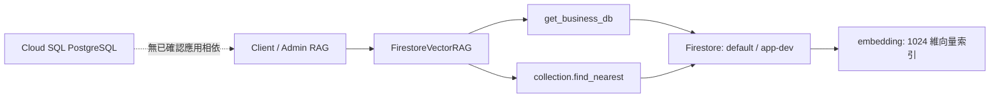

# Cloud SQL 相依追查與停機紀錄

日期：2026-10-10。專案：`anti-harassment-bot`。目標：`anti-harassment-bot-instance`（PostgreSQL 18、`db-f1-micro`、`asia-east1`）。使用者授權：確認無應用使用後關閉服務；採可復原的停止實例，保留資料。

## 向量搜尋實際在哪裡



程式證據：

- `shared/python/rag_core/firestore_clients.py`：`get_business_db()` 回傳 `firebase_admin.firestore.client(database_id=...)`。
- `shared/python/rag_core/rag/firestore_vector.py`：`FirestoreVectorRAG` 使用上述 client，對 collection 呼叫 `find_nearest(vector_field="embedding", distance_measure=COSINE)`。
- 正式 Firestore 的 `rag_documents`、`rag_judgments`、`rag_remedies` 三組 `embedding` 向量索引皆為 READY、1024 維。
- Repository 無 SQL driver／SQL 連線／Data Connect SDK 呼叫。`pnpm-lock.yaml` 中的 `@firebase/data-connect@0.7.4` 是 `firebase@12.19.0` 的傳遞相依；目前前端使用 `firebase/app` 與 `firebase/analytics`，不能由安裝了套件推論已使用服務。

Firestore 原生向量搜尋與 Firebase Data Connect 的 PostgreSQL 路徑是不同資料存取機制；本專案使用前者。[Firestore 官方向量搜尋文件](https://firebase.google.com/docs/firestore/vector-search)

## 雲端相依盤點

| 檢查 | 結果 |
|---|---|
| Data Connect，所有 locations | `projects/anti-harassment-bot/locations/-/services` 回傳空清單 |
| Cloud Functions | 僅 `api`、`api_preview`、`admin_api`、`admin_api_preview` |
| Cloud Run services | 僅上述四個對應服務，沒有 Cloud SQL instance annotation／volume |
| Cloud Run jobs | 空清單 |
| 四個服務 SQL 環境變數名稱 | 沒有 SQL／POSTGRES／DATABASE_URL／INSTANCE_CONNECTION 類設定；未輸出環境變數值 |
| Cloud SQL databases | 僅 `postgres`，未讀取資料表內容 |
| Cloud SQL users | 僅 `postgres` |
| SQL replica／master 相依 | 無 replicaNames／masterInstanceName |
| SQL 網路設定 | 公開 IPv4，未設定 authorized networks，未列 private IP network |
| SQL 歷史標籤 | `firebase-data-connect: ft`；表示曾關聯 Data Connect 的線索，不能證明目前仍使用 |

此盤點涵蓋本 repository、目前四個部署服務、Data Connect 與監控紀錄；無法由此排除所有外部人員曾使用 SQL 的可能性，因此不刪除資料。

## 使用量證據與解讀

監控期間：2026-09-10 至 2026-10-10 UTC。

- `postgres` 最近 7 天的 `num_backends`：168 個逐小時最大值樣本，全部為 0，沒有分頁遺漏。
- 最近 30 天曾觀察到最大 1 條 `postgres` 連線；active-state 指標有兩個日區間，最近為 9 月 29 日結束的區間。不能宣稱「歷史上完全無人使用」。
- `cloudsqladmin` 有 1–3 條內部管理連線，且 `postgres`、`template1` 有少量 transaction 指標。這些數字本身不能證明應用在讀寫資料；本次沒有取得可歸因到應用的查詢紀錄。
- 30 天連線關鍵字／connect audit 查詢沒有回傳紀錄；log absence 不等於所有 SQL 連線都已開啟稽核或從未發生。

綜合程式、部署相依與最近一週連線樣本，未找到目前應用使用 Cloud SQL 的證據，足以採取保留資料的停止操作。

## 操作與恢復

已提交的操作只修改 `settings.activationPolicy`：

```sh
gcloud sql instances patch anti-harassment-bot-instance \
  --project=anti-harassment-bot --activation-policy=NEVER --quiet
```

Operation：`e4d0620d-b155-4437-bb08-85ee00000025`。

恢復方式：

```sh
gcloud sql instances patch anti-harassment-bot-instance \
  --project=anti-harassment-bot --activation-policy=ALWAYS --quiet
```

停止會保留實例與資料，停止運算執行個體計費；儲存與 IP 費用仍可能存在。未刪除實例、未關閉 Firestore、未停用專案 API，也未移除 Data Connect service-agent IAM。停止不等於費用完全歸零。[Google Cloud 停止實例說明](https://docs.cloud.google.com/sql/docs/postgres/start-stop-restart-instance)

## 停機完成與實測結果

- Operation：DONE、無 error；完成於 **2026-10-10 06:56:37 UTC／14:56:37 台灣時間**。
- 實例讀回：`state=STOPPED`、`settings.activationPolicy=NEVER`。
- SQL 停止後，使用既有 embedding 對 `(default)` 與 `app-dev` 的 `rag_documents`、`rag_judgments`、`rag_remedies` 執行 `find_nearest`：**6/6 成功**，各回傳 1 筆。
- 正式／Preview 的 Client／Admin health：**4/4 HTTP 200**。
- 以上向量驗證以 operator 身分直接查 Firestore，只輸出成功狀態與筆數，未輸出文件、向量或憑證。它證明 Firestore 向量查詢在 SQL 關閉後可運作，並不等同完整使用者聊天或模型品質驗收。
- 未呼叫外部 LLM、未寫入應用資料、未刪除 SQL 資料。
