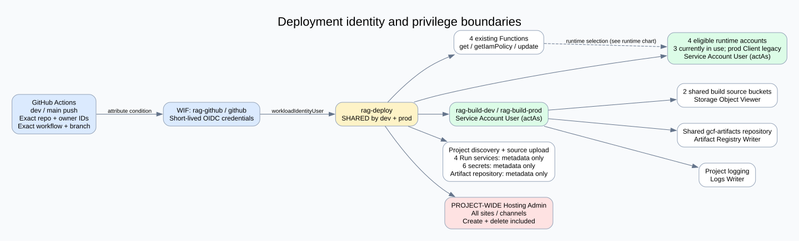
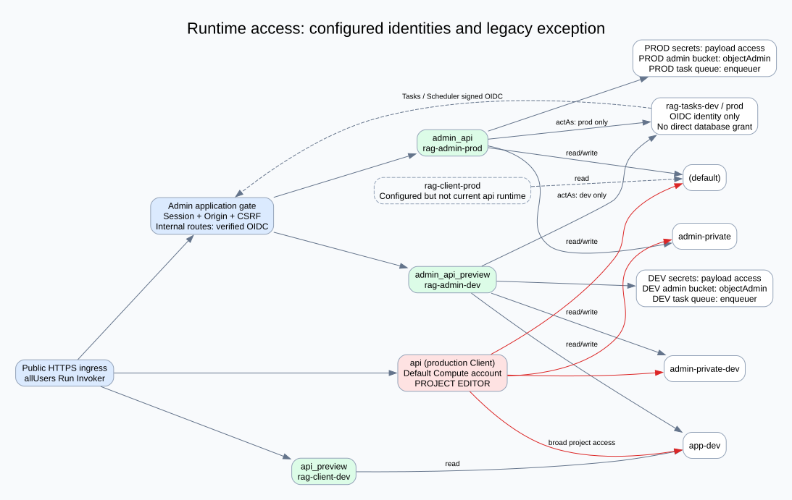

# 現行權限配置與部署修復報告

專案：`anti-harassment-bot`（`741986685144`）。區域：`asia-east1`。盤點日期：2026-10-10（Asia/Taipei）。

本報告區分「雲端實際綁定」、「應用程式驗證」與「尚未切換的設計」。身分名稱省略 `@anti-harassment-bot.iam.gserviceaccount.com` 時，均指同專案服務帳號。IAM 原始資料僅保存在本機忽略目錄；本報告不包含密碼、Token、金鑰或 Secret payload。

## 1. 部署錯誤與修正

原失敗工作：[Preview run 38021319103](https://github.com/TWCkaijin/Anti-Harassment-Bot/actions/runs/38021319103)，第 3 次執行、commit `65073092f3a5442fda8a38f110e2040ded378603`。WIF 驗證與三項 CI Gate 已通過，但 Admin Function 更新失敗。

2026-10-10 05:54 UTC 的 Cloud Audit Logs 顯示：`rag-deploy` 具有 Function update 與 `rag-admin-dev` 的 `iam.serviceAccounts.actAs`，卻缺少預設 Compute 建置帳號的 `actAs`。原因是原 provisioning 僅涵蓋四個執行帳號，遺漏 `buildConfig.serviceAccount`。

修正採專用 `rag-build-dev` / `rag-build-prod`。部署帳號僅在這兩個帳號上增加 `roles/iam.serviceAccountUser`；Builder 僅取得建置來源 bucket 讀取、`gcf-artifacts` 映像寫入與 project 日誌寫入。更新 API 的 mask 僅為 `buildConfig.serviceAccount`。設定更新會觸發 Google 重新建置既有程式，可能複製 ZIP 成新 generation；驗證採來源 checksum 與執行設定比對。

本地程式增加部署前建置帳號檢查，避免打包後才發現設定錯誤。CLI 失敗訊息只顯示 exit code 與白名單 permission 名稱，不輸出可能含憑證的原始錯誤物件。

## 2. 部署權限圖

[可編輯 Graphviz 原始檔](deployment.dot)。實際部署結果與帳號切換狀態見本文末尾的驗證紀錄。

### GitHub → WIF → Google 服務帳號

| 項目 | 現行值／限制 |
|---|---|
| Repository | `TWCkaijin/Anti-Harassment-Bot` |
| 固定 repository ID | `1253167044` |
| 固定 owner ID | `92873112` |
| OIDC issuer | `https://token.actions.githubusercontent.com` |
| Pool / provider | `rag-github` / `github`，ACTIVE |
| 可接受事件 | 僅 `push` |
| 正式部署 | `refs/heads/main` + `.github/workflows/deploy-main.yml@refs/heads/main` |
| Preview 部署 | `refs/heads/dev` + `.github/workflows/deploy-dev.yml@refs/heads/dev` |
| OIDC attribute mapping | `google.subject=assertion.sub`；`attribute.repository_id=assertion.repository_id` |
| WIF 綁定 | 該 repository ID 的 principalSet → `rag-deploy` 上的 `roles/iam.workloadIdentityUser` |
| GitHub token | workflow 預設 `contents: read`；deploy job 額外 `id-token: write` |

這條路徑使用短效身分聯邦，不依賴下載服務帳號 JSON 金鑰。它不代表專案不存在其他金鑰；本次未盤點所有使用者管理金鑰。

**重要邊界：** dev 與 main 共用 `rag-deploy`。WIF 檢查能限制誰取得帳號，但取得後兩個分支具有相同 GCP 權限，可更新四個 Function，也可操作正式 Hosting。它不是 GCP 層的 dev/prod 隔離。若要硬性隔離，後續應拆分部署帳號、principal 條件與 Hosting 專案。

### rag-deploy 的直接權限

| 資源範圍 | 角色 | 實際能力 |
|---|---|---|
| Project | 自訂 `ragDeployMetadata` | 專案／Firebase／API metadata、列出 Functions、建立來源上傳 URL、讀 operation |
| 四個既有 Function | 自訂 `ragFunctionUpdater` | get、getIamPolicy、update；不含 create/delete/setIamPolicy |
| 四個對應 Run service | 自訂 `ragRunMetadata` | get、getIamPolicy；不含更新服務或 IAM |
| 六個 RAG Secret | `roles/secretmanager.viewer` | 讀 metadata；不含直接讀 Secret payload |
| 四個專用 runtime SA | `roles/iam.serviceAccountUser` | 部署時指定其身分（actAs） |
| 兩個專用 build SA | `roles/iam.serviceAccountUser` | 指定建置身分；依實際切換驗證紀錄 |
| `gcf-artifacts` repository | 自訂 `ragArtifactMetadata` | 讀 repository metadata／cleanup policy |
| Project 全部 Hosting | `roles/firebasehosting.admin` | 管理所有 site、版本、release、channel；包含建立與刪除能力 |

**間接能力不可忽略：** 雖然 `rag-deploy` 沒有直接的 Firestore 資料權限或 Secret payload accessor，但它可以更新以 Admin 身分執行的程式。因此取得部署權限者可透過部署程式，間接使用該 runtime 的資料與 Secret 能力。不能把「無直接 accessor」解釋為「不能取得資料」。

`FIREBASE_SKIP_INFORMATIONAL_IAM=1` 只略過 CLI 對舊 appspot 帳號的資訊性預檢，GCP API 仍會實際檢查 Function 與建置／執行帳號權限。

### Builder 權限及共用範圍

| 權限 | 範圍 |
|---|---|
| `roles/logging.logWriter` | Project |
| `roles/artifactregistry.writer` | `asia-east1/gcf-artifacts` |
| `roles/storage.objectViewer` | `gcf-v2-sources-741986685144-asia-east1` |
| `roles/storage.objectViewer` | `gcf-v2-uploads-741986685144.asia-east1.cloudfunctions.appspot.com` |

建置帳號沒有新增 Firestore、Secret accessor、Editor、Owner 或 runtime actAs。兩環境仍共用上述來源 buckets 與映像 repository，因此 Builder 的來源可讀範圍與映像寫入範圍尚未依環境隔離。

## 3. 執行與資料存取圖

[可編輯 Graphviz 原始檔](runtime.dot)。圖中虛線的 `rag-client-prod` 已有權限，但正式 `api` 尚未使用它。

| Function | 執行帳號（現況） | 說明 |
|---|---|---|
| `api_preview` | `rag-client-dev` | Preview Client，專用讀取帳號 |
| `admin_api_preview` | `rag-admin-dev` | Preview Admin，專用管理帳號 |
| `admin_api` | `rag-admin-prod` | 正式 Admin，專用管理帳號 |
| `api` | `741986685144-compute@developer.gserviceaccount.com` | **舊正式 Client，仍具有 project Editor** |

### Firestore 條件式權限

| 帳號 | 角色 | IAM condition 允許的 database |
|---|---|---|
| `rag-client-dev` | `roles/datastore.viewer` | `app-dev` |
| `rag-client-prod` | `roles/datastore.viewer` | `(default)`；目前不是正式 api 執行帳號 |
| `rag-admin-dev` | `roles/datastore.user` | `app-dev`、`admin-private-dev` |
| `rag-admin-prod` | `roles/datastore.user` | `(default)`、`admin-private` |

條件綁在 project policy，使用完整名稱 `resource.name=="projects/anti-harassment-bot/databases/<database>"`。這是 database 層隔離，不是 collection 或 document 層隔離；Admin 在被允許的 database 內可讀寫資料。伺服器 SDK 的 IAM 授權與瀏覽器端 Firebase Security Rules 是不同機制。本次盤點不能替代每條資料存取路徑的實際允許／拒絕測試。

**舊身分例外：** Compute Editor 與 appspot Editor 都有超出上述條件綁定的 project 權限，會破壞「全專案已完全最小權限化」的說法。本次修正沒有直接撤除它們，因正式 Client 仍依賴 Compute 帳號；正式切換與舊權限回收需另行驗證。

### Secrets、Storage 與工作佇列

| 身分 | Secret payload | Storage | Cloud Tasks |
|---|---|---|---|
| Client dev | `RAG_OPENROUTER_DEV`、`RAG_CLARIFICATION_DEV`、`RAG_CLARIFICATION_LEGACY_DEV` | 無專用 bucket grant | 無專用 queue grant |
| Client prod（已配置 SA） | 相同三類 `_PROD` | 無專用 bucket grant | 無專用 queue grant |
| Admin dev | 相同三類 `_DEV` | `anti-harassment-bot-admin-dev` 的 objectAdmin | `rag-admin-dev` queue 的 enqueuer |
| Admin prod | 相同三類 `_PROD` | `anti-harassment-bot-admin-prod` 的 objectAdmin | `rag-admin-prod` queue 的 enqueuer |
| rag-deploy | 六個 Secret 的 metadata viewer | 來源上傳依 Function API | 無專用 queue grant |
| rag-tasks-dev / prod | 無專用 accessor | 無專用 grant | 作為工作呼叫 OIDC 身分 |

`objectAdmin` 包含物件讀、寫、刪除，不是只允許上傳。Bucket 仍含 `projectEditor`／`projectOwner` 的 legacy bucket/object owner 與 `projectViewer` legacy reader 綁定，因此不可僅查看 `rag-admin-*` 那一列就宣稱 bucket 僅該帳號可讀。

## 4. 公開入口與應用層管理權限

四個 Cloud Run service 都有 `allUsers → roles/run.invoker`。這代表網際網路請求能到達程式入口；Admin 的資料操作是否允許，取決於應用層驗證。

本地 `admin_app/auth.py` 的保護包括：Argon2id 密碼驗證、不透明 `__session` cookie、Firestore session 狀態每次驗證、auth_version／停用／撤銷／過期檢查、Origin 檢查、寫入操作的 CSRF token、登入與工作階段流量限制。Cookie 設為 HttpOnly、SameSite=Strict，雲端設定要求 Secure。這是程式實作核對，不代表本次重新完成所有登入正反向測試。

目前管理應用採 `shared-admin` 共用管理身分，不是每位管理者各自帳號與細分 RBAC。Google Cloud 的 Owner 身分與應用網站的管理登入也不是同一個授權系統。

`/internal/*` 不使用管理 session，而是驗證 Google OIDC token 的 audience、email、email_verified。每個 Admin runtime 只在同環境的 `rag-tasks-*` 帳號上具有 actAs。Scheduler 每 5 分鐘使用該帳號呼叫 `/internal/maintenance/reconcile`；Cloud Tasks 同樣帶 OIDC 呼叫工作路由。`rag-tasks-*` 本身沒有直接 Firestore 資料 grant。

## 5. GitHub 保護的實際狀態

本次 API 查詢：傳統 main/dev branch protection 回傳「Branch not protected」，但另有 ACTIVE repository ruleset `production-protection`，對 `~DEFAULT_BRANCH`（目前是 `main`）生效，包含禁止刪除、禁止 non-fast-forward、限制更新及 Copilot code review。Repository Admin role 可 always bypass。不能只根據傳統 protection API 的 404 宣稱完全沒有保護。

部署 workflow 沒有指定 GitHub `environment:`。目前 repository environments 僅有 `copilot`，沒有正式／Preview 部署人工批准關卡。三個 CI Gate 是 workflow 的依賴步驟；目前 ruleset 未列出 required status checks 或 required pull-request approvals。

## 6. 保留的高權限與改善優先順序

| 優先度 | 現況 | 含意／後續方向 |
|---|---|---|
| 高 | 正式 api 使用 Compute Editor | 正式 Client 切換專用 SA 並實測後，再回收舊 Editor；本次未執行切換 |
| 高 | dev/main 共用部署 SA | dev 部署憑證也可改正式 Function／Hosting；拆分 SA 與信任條件 |
| 高 | Project Hosting Admin | 不是 site 層限制；若需可靠環境隔離，考慮分專案 |
| 中 | appspot 仍有 Editor、Firebase Admin、Cloud Deploy Editor、SA User | 確认既有用途後分批回收，避免中斷舊流程 |
| 中 | Firebase Admin SDK SA 有 project Token Creator、SA User 等 | 可產生／代行身分的範圍寬；需盤點使用者與金鑰用途 |
| 中 | Builder 共用來源／artifact 範圍 | 建置帳號分開仍非完整環境隔離 |
| 中 | Owner、Editor 的 bucket legacy grants | 專用 bucket grant 不能排除既有高權限者 |
| 中 | 共用管理密碼與 session 身分 | 無法提供每位管理者的獨立 RBAC／完整個人追溯 |

本報告的「無專用 grant」是所列 project／resource allow policy 的結果；未聲稱已完成組織／folder 繼承、IAM deny、PAB、所有自訂 ACL、所有帳號金鑰及全部外部系統的完整有效權限分析。

## 7. GUI 檢視位置與重現

- Google Cloud Console → IAM 與管理 → IAM：查看 project roles；展開條件看 database resource.name。勾選顯示 Google 提供角色，才能看 service agents。
- IAM 與管理 → 工作負載身分聯邦 → `rag-github` → `github`：檢視 issuer、attribute mapping／condition。
- IAM 與管理 → 服務帳戶 → `rag-deploy` → 權限：檢視 federated principal；在各 runtime/build 帳號的權限頁看誰具有 Service Account User。
- Cloud Run → Functions／對應服務 → 詳細資料：分別看 build account 與 runtime account；兩者不是同一欄。
- Secret Manager → 指定 `RAG_*` → 權限：區分 Viewer 與 Secret Accessor，不需要開啟 Secret value。
- Cloud Storage → bucket → 權限；Artifact Registry → `gcf-artifacts` → 權限；Cloud Tasks → queue → 權限：看資源層 grant。
- GitHub repository → Settings → Rules → Rulesets，以及 Settings → Environments：分別核對分支規則與部署批准關卡。

可重現的修復入口：`python scripts/provision_build.py --environment preview` 預設只列出計畫；加入 `--apply` 才修改。正式使用 `--environment production`。一般 CI 不應取得 provisioning 所需 IAM 管理權限。

## 8. 官方依據

- [Cloud Run functions build process 與自訂 build service account](https://docs.cloud.google.com/functions/docs/building)：建置帳號與來源／artifact／logging 權限。
- [Cloud Functions v2 patch API](https://docs.cloud.google.com/functions/docs/reference/rest/v2/projects.locations.functions/patch)：使用 updateMask 限制設定更新欄位。

下列附錄由本次實際 IAM snapshot 產生；個人 Owner email 以編號代稱，保留角色與成員數量。
## 附錄 A. Project 與各資源 allow policy 明細

擷取時間（UTC）：`2026-10-10T06:25:17.664276+00:00`。下表包括 Google service agents 與舊帳號；個人 Owner 共 2 位，原 email 未公開。這是 allow bindings 清單，不是完整權限可達性推導。

### project

| Role | Member | Condition |
|---|---|---|
| `custom:ragDeployMetadata` | `rag-deploy` | 無條件 |
| `roles/artifactregistry.serviceAgent` | `service-741986685144@gcp-sa-artifactregistry.iam.gserviceaccount.com` | 無條件 |
| `roles/cloudaicompanion.serviceAgent` | `service-741986685144@gcp-sa-cloudaicompanion.iam.gserviceaccount.com` | 無條件 |
| `roles/cloudbuild.builds.builder` | `741986685144@cloudbuild.gserviceaccount.com` | 無條件 |
| `roles/cloudbuild.serviceAgent` | `service-741986685144@gcp-sa-cloudbuild.iam.gserviceaccount.com` | 無條件 |
| `roles/cloudconfig.admin` | `firebase-adminsdk-fbsvc` | 無條件 |
| `roles/clouddeploy.editor` | `anti-harassment-bot@appspot.gserviceaccount.com` | 無條件 |
| `roles/cloudfunctions.serviceAgent` | `service-741986685144@gcf-admin-robot.iam.gserviceaccount.com` | 無條件 |
| `roles/cloudscheduler.serviceAgent` | `service-741986685144@gcp-sa-cloudscheduler.iam.gserviceaccount.com` | 無條件 |
| `roles/cloudtasks.serviceAgent` | `service-741986685144@gcp-sa-cloudtasks.iam.gserviceaccount.com` | 無條件 |
| `roles/containerregistry.ServiceAgent` | `service-741986685144@containerregistry.iam.gserviceaccount.com` | 無條件 |
| `roles/datastore.user` | `rag-admin-prod` | `resource.name=="projects/anti-harassment-bot/databases/(default)" || resource.name=="projects/anti-harassment-bot/databases/admin-private"` |
| `roles/datastore.user` | `rag-admin-dev` | `resource.name=="projects/anti-harassment-bot/databases/app-dev" || resource.name=="projects/anti-harassment-bot/databases/admin-private-dev"` |
| `roles/datastore.viewer` | `rag-client-dev` | `resource.name=="projects/anti-harassment-bot/databases/app-dev"` |
| `roles/datastore.viewer` | `rag-client-prod` | `resource.name=="projects/anti-harassment-bot/databases/(default)"` |
| `roles/editor` | `741986685144-compute@developer.gserviceaccount.com` `anti-harassment-bot@appspot.gserviceaccount.com` | 無條件 |
| `roles/firebase.admin` | `anti-harassment-bot@appspot.gserviceaccount.com` | 無條件 |
| `roles/firebase.managementServiceAgent` | `service-741986685144@gcp-sa-firebase.iam.gserviceaccount.com` | 無條件 |
| `roles/firebase.sdkAdminServiceAgent` | `firebase-adminsdk-fbsvc` | 無條件 |
| `roles/firebaseauth.admin` | `firebase-adminsdk-fbsvc` | 無條件 |
| `roles/firebasedataconnect.serviceAgent` | `service-741986685144@gcp-sa-firebasedataconnect.iam.gserviceaccount.com` | 無條件 |
| `roles/firebasehosting.admin` | `rag-deploy` | 無條件 |
| `roles/firebaserules.system` | `service-741986685144@firebase-rules.iam.gserviceaccount.com` | 無條件 |
| `roles/firestore.serviceAgent` | `service-741986685144@gcp-sa-firestore.iam.gserviceaccount.com` | 無條件 |
| `roles/iam.serviceAccountTokenCreator` | `firebase-adminsdk-fbsvc` | 無條件 |
| `roles/iam.serviceAccountUser` | `anti-harassment-bot@appspot.gserviceaccount.com` `firebase-adminsdk-fbsvc` | 無條件 |
| `roles/logging.logWriter` | `rag-admin-dev` `rag-admin-prod` `rag-build-dev` `rag-build-prod` `rag-client-dev` `rag-client-prod` | 無條件 |
| `roles/owner` | `user:owner-1 (redacted)` `user:owner-2 (redacted)` | 無條件 |
| `roles/run.serviceAgent` | `service-741986685144@serverless-robot-prod.iam.gserviceaccount.com` | 無條件 |

### function-policy-api

| Role | Member | Condition |
|---|---|---|
| `custom:ragFunctionUpdater` | `rag-deploy` | 無條件 |

### function-policy-api_preview

| Role | Member | Condition |
|---|---|---|
| `custom:ragFunctionUpdater` | `rag-deploy` | 無條件 |

### function-policy-admin_api

| Role | Member | Condition |
|---|---|---|
| `custom:ragFunctionUpdater` | `rag-deploy` | 無條件 |

### function-policy-admin_api_preview

| Role | Member | Condition |
|---|---|---|
| `custom:ragFunctionUpdater` | `rag-deploy` | 無條件 |

### sa-rag-deploy

| Role | Member | Condition |
|---|---|---|
| `roles/iam.workloadIdentityUser` | `principalSet://iam.googleapis.com/projects/741986685144/locations/global/workloadIdentityPools/rag-github/attribute.repository_id/1253167044` | 無條件 |

### sa-rag-client-dev

| Role | Member | Condition |
|---|---|---|
| `roles/iam.serviceAccountUser` | `rag-deploy` | 無條件 |

### sa-rag-client-prod

| Role | Member | Condition |
|---|---|---|
| `roles/iam.serviceAccountUser` | `rag-deploy` | 無條件 |

### sa-rag-admin-dev

| Role | Member | Condition |
|---|---|---|
| `roles/iam.serviceAccountUser` | `rag-deploy` | 無條件 |

### sa-rag-admin-prod

| Role | Member | Condition |
|---|---|---|
| `roles/iam.serviceAccountUser` | `rag-deploy` | 無條件 |

### sa-rag-tasks-dev

| Role | Member | Condition |
|---|---|---|
| `roles/iam.serviceAccountUser` | `rag-admin-dev` | 無條件 |

### sa-rag-tasks-prod

| Role | Member | Condition |
|---|---|---|
| `roles/iam.serviceAccountUser` | `rag-admin-prod` | 無條件 |

### sa-rag-build-dev

| Role | Member | Condition |
|---|---|---|
| `roles/iam.serviceAccountUser` | `rag-deploy` | 無條件 |

### sa-rag-build-prod

| Role | Member | Condition |
|---|---|---|
| `roles/iam.serviceAccountUser` | `rag-deploy` | 無條件 |

### secret-RAG_OPENROUTER_DEV

| Role | Member | Condition |
|---|---|---|
| `roles/secretmanager.secretAccessor` | `rag-admin-dev` `rag-client-dev` | 無條件 |
| `roles/secretmanager.viewer` | `rag-deploy` | 無條件 |

### secret-RAG_CLARIFICATION_DEV

| Role | Member | Condition |
|---|---|---|
| `roles/secretmanager.secretAccessor` | `rag-admin-dev` `rag-client-dev` | 無條件 |
| `roles/secretmanager.viewer` | `rag-deploy` | 無條件 |

### secret-RAG_CLARIFICATION_LEGACY_DEV

| Role | Member | Condition |
|---|---|---|
| `roles/secretmanager.secretAccessor` | `rag-admin-dev` `rag-client-dev` | 無條件 |
| `roles/secretmanager.viewer` | `rag-deploy` | 無條件 |

### secret-RAG_OPENROUTER_PROD

| Role | Member | Condition |
|---|---|---|
| `roles/secretmanager.secretAccessor` | `rag-admin-prod` `rag-client-prod` | 無條件 |
| `roles/secretmanager.viewer` | `rag-deploy` | 無條件 |

### secret-RAG_CLARIFICATION_PROD

| Role | Member | Condition |
|---|---|---|
| `roles/secretmanager.secretAccessor` | `rag-admin-prod` `rag-client-prod` | 無條件 |
| `roles/secretmanager.viewer` | `rag-deploy` | 無條件 |

### secret-RAG_CLARIFICATION_LEGACY_PROD

| Role | Member | Condition |
|---|---|---|
| `roles/secretmanager.secretAccessor` | `rag-admin-prod` `rag-client-prod` | 無條件 |
| `roles/secretmanager.viewer` | `rag-deploy` | 無條件 |

### bucket-anti-harassment-bot-admin-dev

| Role | Member | Condition |
|---|---|---|
| `roles/storage.legacyBucketOwner` | `projectEditor:anti-harassment-bot` `projectOwner:anti-harassment-bot` | 無條件 |
| `roles/storage.legacyBucketReader` | `projectViewer:anti-harassment-bot` | 無條件 |
| `roles/storage.legacyObjectOwner` | `projectEditor:anti-harassment-bot` `projectOwner:anti-harassment-bot` | 無條件 |
| `roles/storage.legacyObjectReader` | `projectViewer:anti-harassment-bot` | 無條件 |
| `roles/storage.objectAdmin` | `rag-admin-dev` | 無條件 |

### bucket-anti-harassment-bot-admin-prod

| Role | Member | Condition |
|---|---|---|
| `roles/storage.legacyBucketOwner` | `projectEditor:anti-harassment-bot` `projectOwner:anti-harassment-bot` | 無條件 |
| `roles/storage.legacyBucketReader` | `projectViewer:anti-harassment-bot` | 無條件 |
| `roles/storage.legacyObjectOwner` | `projectEditor:anti-harassment-bot` `projectOwner:anti-harassment-bot` | 無條件 |
| `roles/storage.legacyObjectReader` | `projectViewer:anti-harassment-bot` | 無條件 |
| `roles/storage.objectAdmin` | `rag-admin-prod` | 無條件 |

### bucket-gcf-v2-sources-741986685144-asia-east1

| Role | Member | Condition |
|---|---|---|
| `roles/storage.legacyBucketOwner` | `projectEditor:anti-harassment-bot` `projectOwner:anti-harassment-bot` | 無條件 |
| `roles/storage.legacyBucketReader` | `projectViewer:anti-harassment-bot` | 無條件 |
| `roles/storage.legacyObjectOwner` | `projectEditor:anti-harassment-bot` `projectOwner:anti-harassment-bot` | 無條件 |
| `roles/storage.legacyObjectReader` | `projectViewer:anti-harassment-bot` | 無條件 |
| `roles/storage.objectViewer` | `rag-build-dev` `rag-build-prod` | 無條件 |

### bucket-gcf-v2-uploads-741986685144.asia-east1.cloudfunctions.appspot.com

| Role | Member | Condition |
|---|---|---|
| `roles/storage.legacyBucketOwner` | `projectEditor:anti-harassment-bot` `projectOwner:anti-harassment-bot` | 無條件 |
| `roles/storage.legacyBucketReader` | `projectViewer:anti-harassment-bot` | 無條件 |
| `roles/storage.legacyObjectOwner` | `projectEditor:anti-harassment-bot` `projectOwner:anti-harassment-bot` | 無條件 |
| `roles/storage.legacyObjectReader` | `projectViewer:anti-harassment-bot` | 無條件 |
| `roles/storage.objectViewer` | `rag-build-dev` `rag-build-prod` | 無條件 |

### artifacts

| Role | Member | Condition |
|---|---|---|
| `custom:ragArtifactMetadata` | `rag-deploy` | 無條件 |
| `roles/artifactregistry.writer` | `rag-build-dev` `rag-build-prod` | 無條件 |

### queue-dev

| Role | Member | Condition |
|---|---|---|
| `roles/cloudtasks.enqueuer` | `rag-admin-dev` | 無條件 |

### queue-prod

| Role | Member | Condition |
|---|---|---|
| `roles/cloudtasks.enqueuer` | `rag-admin-prod` | 無條件 |

### run-api

| Role | Member | Condition |
|---|---|---|
| `custom:ragRunMetadata` | `rag-deploy` | 無條件 |
| `roles/run.invoker` | `allUsers` | 無條件 |

### run-api_preview

| Role | Member | Condition |
|---|---|---|
| `custom:ragRunMetadata` | `rag-deploy` | 無條件 |
| `roles/run.invoker` | `allUsers` | 無條件 |

### run-admin_api

| Role | Member | Condition |
|---|---|---|
| `custom:ragRunMetadata` | `rag-deploy` | 無條件 |
| `roles/run.invoker` | `allUsers` | 無條件 |

### run-admin_api_preview

| Role | Member | Condition |
|---|---|---|
| `custom:ragRunMetadata` | `rag-deploy` | 無條件 |
| `roles/run.invoker` | `allUsers` | 無條件 |

## 附錄 B. 自訂角色的完整 permission

### ragDeployMetadata

- `cloudfunctions.functions.list`
- `cloudfunctions.functions.sourceCodeSet`
- `cloudfunctions.locations.list`
- `cloudfunctions.operations.get`
- `firebase.clients.get`
- `firebase.projects.get`
- `resourcemanager.projects.get`
- `serviceusage.services.get`
- `serviceusage.services.list`
- `serviceusage.services.use`

### ragFunctionUpdater

- `cloudfunctions.functions.get`
- `cloudfunctions.functions.getIamPolicy`
- `cloudfunctions.functions.update`

### ragRunMetadata

- `run.services.get`
- `run.services.getIamPolicy`

### ragArtifactMetadata

- `artifactregistry.repositories.get`

## 附錄 C. 現行 Function 建置／執行對照

| Function | State | Builder | Runtime | 最後更新 UTC |
|---|---|---|---|---|
| `api` | ACTIVE | `rag-build-prod` | `741986685144-compute@developer.gserviceaccount.com` | 2026-10-10T06:24:46.131164692Z |
| `api_preview` | ACTIVE | `rag-build-dev` | `rag-client-dev` | 2026-10-10T06:24:14.400938919Z |
| `admin_api` | ACTIVE | `rag-build-prod` | `rag-admin-prod` | 2026-10-10T06:22:10.462448187Z |
| `admin_api_preview` | ACTIVE | `rag-build-dev` | `rag-admin-dev` | 2026-10-10T06:22:59.507190579Z |

完整可機讀資料：[已遮蔽個人 email 的 IAM snapshot](iam-snapshot.redacted.json)。

## 9. 修正完成與驗證紀錄

**結果：GitHub Preview 部署已成功。** [Run 38021319103，第 4 次執行](https://github.com/TWCkaijin/Anti-Harassment-Bot/actions/runs/38021319103/attempts/4) 於 **2026-10-10 14:24:52 台灣時間**完成。部署 job 成功，原三項 CI Gate 的成功結果由 failed-job rerun 沿用，並非本次重跑全部 Gate。

| 驗證層級 | 結果與界線 |
|---|---|
| Preview GitHub 實際部署 | SUCCESS；既有遠端 commit `65073092f3a5442fda8a38f110e2040ded378603`；Functions 與 Hosting 步驟完成 |
| 四個 Function 最終狀態 | 全部 ACTIVE；Preview builder = `rag-build-dev`，Production builder = `rag-build-prod` |
| Production 修改範圍 | 僅建置帳號設定；Google 重建既有來源並更新 revision，未執行 main GitHub 部署或切換正式 Client runtime |
| 來源保存 | 設定更新前後來源 ZIP 大小／MD5／CRC32C 一致；runtime SA、環境設定、Secret references 比對保留。Preview 隨後由 GitHub 正常重新部署遠端版本 |
| Builder 實際使用 | `rag-build-dev` 與 `rag-build-prod` 的 Cloud Build 均有 SUCCESS 紀錄 |
| 部署後唯讀探測 | Preview／Production Admin health 200；Preview Client health 200；未登入的 Preview Admin session 回傳 401；未做登入或模型呼叫 |
| 本地後端測試 | `pytest client/tests admin/tests shared/tests -q --tb=short`：**1,403 passed** |
| 本次針對性測試 | 6 passed，涵蓋建置帳號預檢、狹窄 PATCH、來源 fingerprint 與錯誤訊息不洩漏測試值 |
| 本地 lint／format | Ruff check 通過；155 個 Python 檔案格式檢查通過 |
| 圖解 | 兩張 Graphviz 圖已渲染及目視檢查；HTML 嵌入 SVG，可離線閱讀 |
| 最終 IAM snapshot | 2026-10-10 06:25:17 UTC（14:25:17 台灣時間）；讀取項目無錯誤 |
| Git 狀態界線 | 本次本地防呆與文件變更尚未 commit／push；成功的雲端 rerun 驗證 IAM 修正，不代表新本地程式已上傳 |
| 未包含的驗證 | 未呼叫外部 LLM、未重新跑真實模型案例、未完成正式 Client 身分遷移，也未宣稱全專案已達完整最小權限 |

成功建置證據：Preview `9ed47fab-d8e9-4d83-a297-77dae22f91d5`、`78a15bdc-50bb-4b44-8a55-fef0c639b0d9`；Production `772f2e30-e125-44c7-a2b6-100d0c5a3ab1`、`33aecd80-5264-4147-a2cc-771a177e29db`。這些 ID 可在 Cloud Build → History 選擇 `asia-east1` 查閱。
