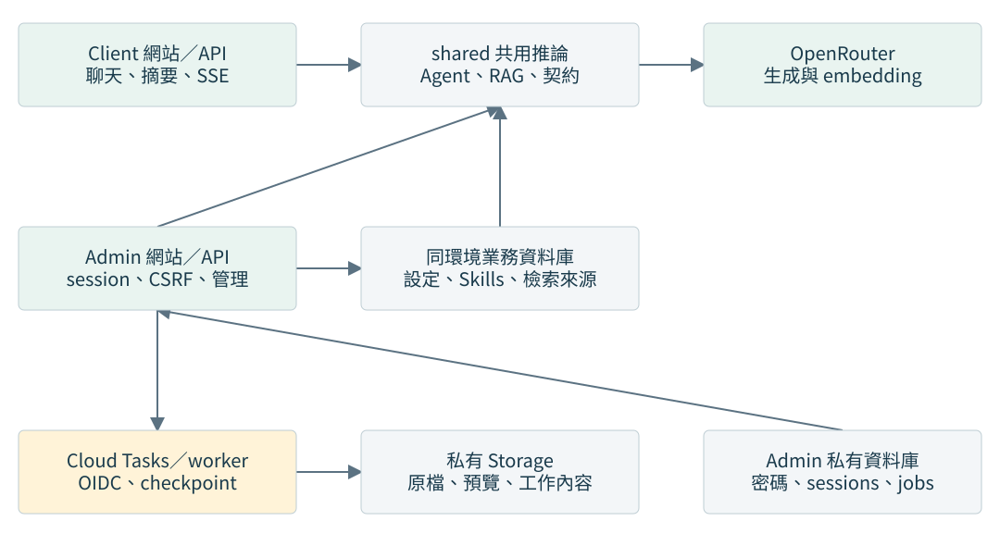
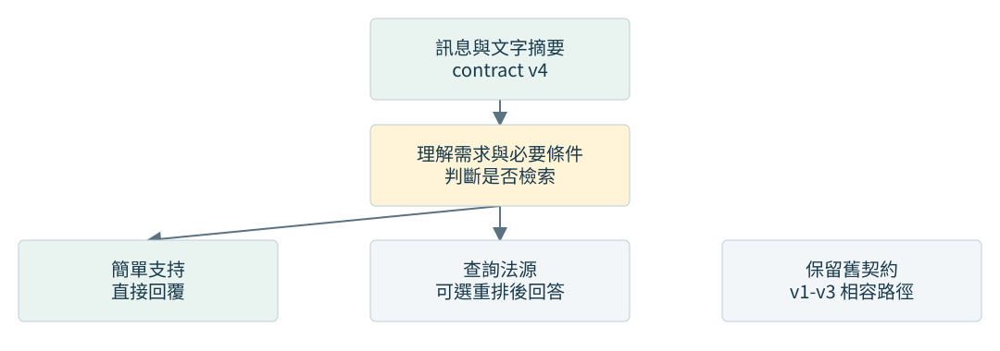
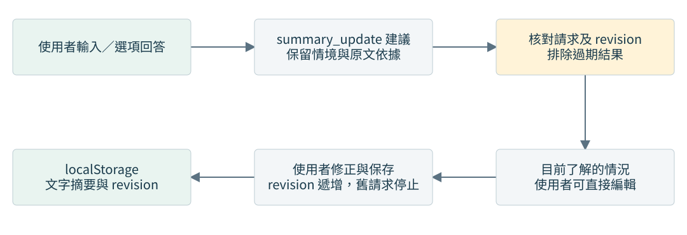
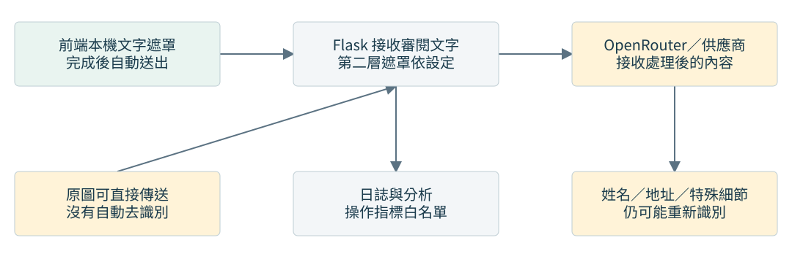
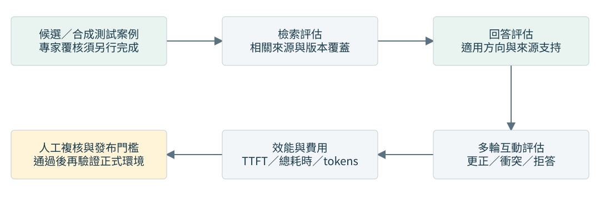

# 性騷擾防治智能 AI 技術報告

版本日期：2026-10-10。描述 Client／Admin 拆分後的原始碼與資料流。各項本機及雲端驗收結果見 [遷移報告](../MIGRATION_REPORT.md)，文件中的設計說明不代表所有雲端切換已完成。

## 1. 系統用途與組成

本系統提供性騷擾相關初步支持、資訊整理與法規／求助方向。前端使用 React、TypeScript、Vite、Tailwind CSS；後端為 Flask，透過 Firebase Functions 對外提供 HTTP 與 SSE。生成模型由 OpenRouter 提供，RAG 使用 Firestore 法規、判決及救濟資料。模型輸出不能取代專業判斷或正式申訴程序。

Client 與 Admin 各有獨立網站及 Flask app，共用 Agent、RAG、契約與遮罩模組。同環境的兩個後端共用業務資料庫：production 為 `(default)`，preview 為 `app-dev`；密碼、sessions、jobs 與操作紀錄則放在 `admin-private`／`admin-private-dev`。

Client 前端保存會話與摘要；聊天 API 依每次請求接收必要歷史及情境，沒有新增後端個案資料庫。Admin 單次診斷請求與結果短期保存並於 24 小時後禁止讀取。平台日誌與模型供應商保存政策仍須獨立確認，不能把 API 無狀態等同全程不留資料。

## 2. 契約與回答流程

health 宣告支援聊天契約 1、2、3、4。前端依能力協商選用版本，v1-v3 相容路徑保留；v4 是目前文字摘要及自然段落功能的主要契約。單一文字摘要不能靜默降級到不支援的舊契約。

v4 對複雜、法律、期限或程序問題先整理需求及檢索線索，再取回資料並生成答案；簡單支持可直接完成。來源驗證以本次取回內容與結構化欄位為依據，理解結果本身不是法源。

v4 以 answer_units 產生自然段落，完整單元通過局部來源檢查後才送出 delta，不必等整份答案完成。v2/v3 則先取得完整結構化回覆再分段。SSE 包含 progress、analysis、reasoning、delta、guidance、done 與 error；詳細欄位見 [API 參考](API_REFERENCE.md)。

reasoning 僅顯示供應商公開提供的文字／摘要，與正式答案分開，頁面重新整理或匯出時不保留。已顯示內容後不自動完整重播；錯誤或取消會標示未完成，只有通過 done 驗證才提交完整 metadata。

模型理解與最終回答均傳入嚴格 JSON Schema，並要求支援參數的模型端點；回傳後仍驗證型別、引用與完成狀態，不只依賴文字指令。詳見 [聊天契約](CHAT_CONTRACT.md)。

## 3. 摘要與多輪一致性

v4 案件 schema 3 使用 summary、summary_origin 及 revision，本機 storage schema 為 4。舊固定欄位會轉為文字並保留 legacyCaseFacts；無法辨識或超長資料不強制覆寫。

使用者可查看、編輯、儲存摘要或儲存後重新回答。查看不會停止回答；開始編輯會停止目前回覆。晚到結果須同時符合會話、請求及 revision，不能蓋掉使用者更正。重新回答沿用原需求，但以更正後摘要為案件事實。具體契約見 [聊天契約](CHAT_CONTRACT.md)。

## 4. RAG 與資料管理

法規、判決及救濟資料各有用途，不能以一種資料替代全部依據。檢索合併精確條號查詢與向量結果，保留來源 ID、metadata、距離與查找方式。索引缺漏、embedding 或資料庫失敗必須與成功零結果區分。

可選 reranking 在擴大候選後重新排序，失敗或逾時回退到原排序，不更换模型重試。candidate_retrieval_ms 與 retrieval_ms 有重疊，不應直接相加；rerank_ms 另列。設定見 [重排與批次統計](RERANKING.md)。

Admin 提供原檔上傳、背景解析、欄位對應、分段預覽及確認後 embedding／發布；支援結構化檔案、文字、可抽取文字的 PDF／DOCX。所有 chunks 準備完成才在同一業務庫交易發布，私有庫 job 依 receipt 對帳。原檔存在私有 Storage，下載需管理驗證；整份來源刪除包含 chunks、原檔及暫存副本。舊資料須先核對 manifest，缺少原檔時不推測還原。

更新／回復工具見 [資料工具](../../admin/backend/admin_app/scripts/README.md)。自動化測試使用合成 fixtures。原始碼、快照與既有匯入預覽不代表雲端已更新；事件時間、適用版本及法律推論仍需專業核對。

## 5. 隱私與輸出邊界

官方前端先對文字做本機規則遮罩，完成後直接送出；首次及後續訊息均不顯示人工確認視窗。送出範圍包括當次訊息、選入的歷史、摘要及追問內容。管理端單筆診斷使用相同處理邊界；Excel 批次另有整批預覽及開始確認。

舊確認設定不再影響前端；小模型及持久化對照表尚未通過整合門檻，正式辨識仍使用本機規則。圖片可原圖傳送，沒有自動 OCR、EXIF 或臉部去識別；格式驗證不是匿名化。既有本機紀錄、匯出與特殊事件細節仍可能識別個人。完整邊界見 [隱私說明](PRIVACY.md)。

## 6. 管理與評估

獨立 Admin 網站提供模型／provider／rerank 設定、Prompt、Skills、維護模式、單筆診斷、三法批次及行為測試。共享密碼在私有庫以 Argon2id hash 保存，登入建立 HttpOnly session；每次管理請求重新驗證，寫入再檢查 CSRF 與 Origin。設定採 revision 比對，診斷工作綁定登入 session 並透過佇列執行。設定可能寫入 Firestore，診斷与測試可能呼叫付費模型。

三法批次支援 Excel 選欄、遮罩預覽、暫停續跑、失敗重試與結果副本。可選參考答案留在瀏覽器；評分採任一法規命中，不等同完整集合正確。行為測試支援逐輪摘要、規則證據與人工覆核；人工結論綁定具體資料雜湊。

工程測試驗證契約與工具運作，候選資料／合成案例不等於專家 gold。既有 resource 結果不改寫，也不視為本次模型品質驗收。真實檢索召回、回答適切性、法律內容、效能與成本需要各自證據。

## 7. 部署與交付

四個 Functions 位於 asia-east1。Client 維持 `api`／`api_preview`、512 MB、180 秒；Admin 為 `admin_api`／`admin_api_preview`、1 GB、900 秒。Admin 耗時工作由 Cloud Tasks 呼叫同一 Function 的 OIDC worker，前端輪詢進度。正式與 preview 分開使用 runtime SA、資料庫 IAM、queue、bucket 及 secrets。

[操作手冊](../OPERATIONS.md) 列出安裝、密碼初始化、五個本機程序、發布與回復。CI 的 main/dev 流程改用 WIF／ADC，先後端再前端。兩份 Functions source 由白名單產生並各自獨立載入；Hosting 僅發布對應前端 dist。Rules 禁止瀏覽器直接讀寫，後端再由資料庫 IAM 與 API allowlist 限制；不宣稱 Admin SDK 的 collection IAM 隔離。

## 8. 驗收與可編輯來源

本報告及三份手冊以 Markdown 為來源，同步提供離線 HTML 與 PDF。diagram JSON 定義架構圖，建置時產生 SVG 與 Mermaid。文件工具可獨立於簡報與 AI 編輯工具運作。

實際程式測試、部署狀態、文件檢查與保護範圍比對結果集中見 [遷移報告](../MIGRATION_REPORT.md)。文件建置工具可以輸出頁數與來源／輸出 SHA-256 至指定位置。工程測試通過不代表模型品質或法律專家審查完成。
